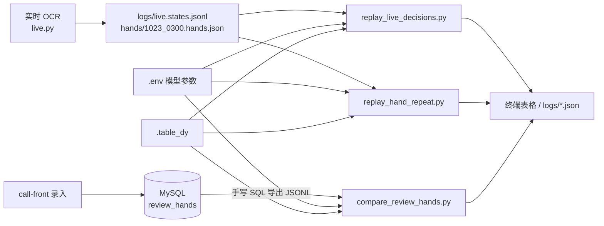
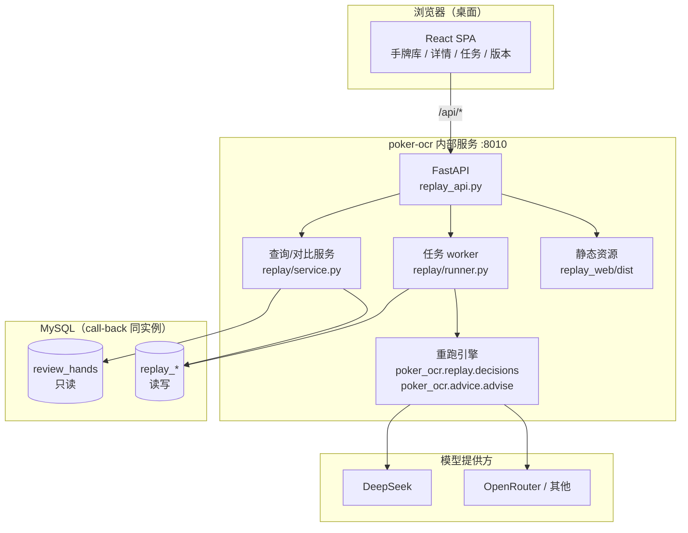
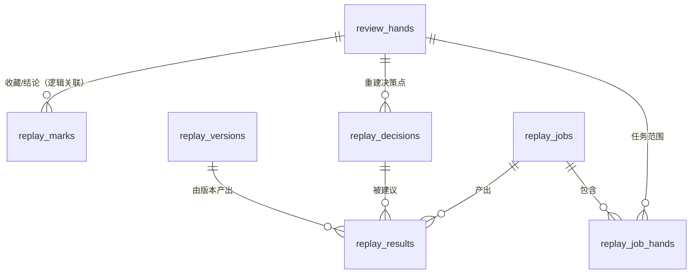

# 手牌复跑控制台（Replay Console）设计文档

| 项目 | 内容 |
| --- | --- |
| 状态 | 设计草案 v0.1；M0–M4 已落地，M5 的手牌导入已落地（见 `replay-console/docs/导入手牌-格式说明.md`） |
| 日期 | 2026-10-23 |
| 关联模块 | `review_hands`、`poker_ocr.advice`、`poker_ocr.table_dynamics`、`tools/compare_review_hands.py`、`tools/replay_hand_repeat.py` |
| 目标读者 | 你（产品/开发）、后续接手的人 |
| 一句话 | 把「选牌 → 重跑 → 逐街对比多版本 AI → 收藏典型手牌 → 一键全部重跑」做成一个可追溯、可取消、可复现的内部 Web 控制台。 |
| 2026-10-29 更新 | live 只保留一套中文 lean（`PROMPT_VERSION=lean-zh-2026-10-30.9`）。新版本 `prompt_style` 只允许 `lean`；旧 `skills` / `lean-rules` 版本与结果**只读**，`run_blockers` 返回 `VERSION_LEGACY_PROMPT`。下文出现 `skills` 的示例均为历史记录。 |

---

## 1. 结论摘要

建议在 `poker-ocr` 里新增一个**独立的内部 Web 控制台**，不改 `call-back` / `call-front` 的生产行为：

- **后端**：`FastAPI` 新应用 `replay_api.py`，独立端口（默认 `8010`），不加载 OCR 模型，不干扰实时链路。
- **前端**：`React 18 + Vite + Ant Design 5 + TanStack Query`，构建后由 FastAPI 托管；开发态 Vite 代理 `/api`。
- **数据库**：复用 `call-back` 的 MySQL 实例；`review_hands` **只读**，新增 `replay_*` 表存版本、任务、决策点、结果、收藏。
- **重跑引擎**：把 `tools/compare_review_hands.py` 里的 `build_decisions()` 抽成 `poker_ocr.replay.decisions`，CLI 与 Web 共用同一套重建逻辑；模型调用继续用 `poker_ocr.advice.advise()`。
- **版本**：一个「AI 版本」不是只有模型名，而是 `模型 + 采样参数 + 提示词风格 + 提示词版本 + 牌桌动态快照 + 重建版本` 的不可变快照。这是「不同版本 AI 在同一条行动街的建议」能长期比较的前提。
- **收藏**：独立的 `replay_marks` 表（收藏、标签、结论、备注），不动 `review_hands`；收藏夹可一键批量重跑，任务范围在创建时冻结。
- **执行**：DB 队列 + 进程内 worker + 结果逐条落库；支持进度、取消、失败重试、重启恢复、成本预估与调用上限。

这套方案的核心不是「再写一个页面」，而是把现在散落在 CLI、`.env`、`.table_dy`、`logs/*.json` 里的**输入、版本、结果**收敛成可查询、可复现的数据。

---

## 2. 现状与问题

### 2.1 现在的链路



现在能跑，但每次重跑都像一次「实验」，而不是一次「操作」：

| 痛点 | 具体表现 | 后果 |
| --- | --- | --- |
| 入口割裂 | 线上手牌在 `live.states.jsonl` / `hands.json`；复盘手牌在 `review_hands`；每次要手写 `mysql ... JSON_OBJECT` 导出 | 想跑「最近 30 手」要先复制一段 SQL，换一批又要改 |
| 版本不可追溯 | 模型名、`temperature`、`thinking`、`prompt_style`、`.table_dy`、git commit 散落在 `.env`、命令行、文件里 | 一周后看到 `logs/replay-flash-20261023b.json`，说不清它到底是哪版提示词、哪版桌风跑出来的 |
| 结果不落库 | 结果是终端表格或 `logs/*.json`，没有按手牌、按决策点、按版本检索的能力 | 无法回答「pro 在 h75 转牌到底说过什么」 |
| 收藏靠记忆 | 没有收藏/典型标签；下次重跑要凭印象重新挑手牌 | 无法沉淀「这套典型手牌」作为回归集 |
| 批量不可控 | 100 手 × 3 版本 = 几百次调用，跑起来是黑盒：没进度、不能取消、失败只能整批重来 | 改一次提示词的成本很高，容易放弃回归 |
| 对比靠肉眼 | 两个 `--model-name` 各跑一遍，两个 JSON 手工 diff；逐街多版本并排看不了 | 「哪个版本在哪条街变好了」看不出来 |
| 重建质量静默 | 翻前盲注被当成下注、缺 hero 动作、`bb=0`、重复手牌等问题只在文档里说明 | 结论被错误快照污染，且页面上没有任何提示 |

### 2.2 关键事实（来自现有代码）

- `review_hands` 已经是一手牌的聚合根：`hero_cards`、`board`、`streets`（按街行动序列）、盲注、`villains`、`result` 都在。
- `tools/compare_review_hands.py` 已经能把 `review_hands` 的行重放成 `HandSnapshot` 决策点，并做规则审计（`audit()`）与三档对比（`classify()`：一致 / 尺度差 / 动作不同）。
- `poker_ocr.advice.advise()` 接受 `Situation + AISettings + style`，返回 `Advice`（option / reason / source / duration_ms），模型不可用时回落到保守选项。
- `.table_dy` 会影响 `build_options()`（松桌开池尺度）与 `value_directive()`，所以它**必须进版本快照**，不能在重跑时临时读当前文件。
- `call-back` 的 `review_analyses` 已经验证了「版本号 + 输入快照 + 原始输出 + 内容指纹」这套可追溯设计；本方案沿用同样的纪律。

---

## 3. 目标与非目标

### 3.1 目标

| 编号 | 目标 | 可验收的信号 |
| --- | --- | --- |
| G1 | 一个入口看全部可重跑手牌 | 列表直接显示手牌、公共牌、位置/筹码、结果、决策点数、最近重跑 |
| G2 | 任意一手牌逐街看多版本建议 | 每个决策点并排显示实际动作 + N 个版本的 option/amount/reason/重复分布 |
| G3 | 收藏典型手牌并一键全部重跑 | 收藏筛选 → 全选 → 选版本 → 一个任务跑完，进度可见 |
| G4 | 结果永久可追溯 | 每条结果都能定位到版本快照、模型参数、提示词版本、桌风哈希、代码 commit |
| G5 | 重跑不污染生产 | `review_hands` 只读；`call-back` / `call-front` 不需要改一行 |
| G6 | 失败可恢复 | 支持取消、失败重试、服务重启后从已落库的结果继续 |

**衡量口径**：现在「改提示词 → 挑 20 手 → 跑 2 个版本 → 逐街对比」大约要 20–40 分钟 CLI + 手工整理；目标降到 **5 分钟内纯点击完成**，且结果可回查。

### 3.2 非目标（明确不做）

- **不替代 call-front 的手牌录入**：v1 只读 `review_hands`；新建/编辑手牌仍走现有复盘页（详情页放一个「去录入」链接）。
- **不改实时建议链路**：`live.py` / `advice.AdviceRunner` / 自动点击不动。
- **不做自动「对错」判定**：页面展示实际动作、硬规则审计标签、人工结论；不把某个版本自动标成「正确」。
- **不做多租户 SaaS**：v1 是单用户内部工具；表里预留 `user_id`，后续再接鉴权。
- **不做训练/评测平台**：不生成 SFT 数据、不做批量评分；这些仍可由 CLI 消费同一批结果。
- **不做移动端适配**：这是桌面端密集表格工具。

---

## 4. 角色与核心场景

### 4.1 角色

- **主要用户**：你，开发者/教练。需要频繁改提示词、换模型、验证某类牌的处理。
- **次要用户**：后续接手的同学。需要在不问你的情况下看懂「这条结论是哪版跑出来的」。
- **不面向**：普通复盘用户（他们继续用 call-front）。

### 4.2 用户故事

| 优先级 | 故事 |
| --- | --- |
| P0 | 我打开手牌库，能看到所有手牌的底牌、公共牌、位置、结果、有几个决策点，并能按收藏/位置/结果/标签筛选。 |
| P0 | 我点开一手牌，能按翻前/翻牌/转牌/河牌看行动线，并在每个 hero 决策点看到「实际动作」和「各版本 AI 的建议」。 |
| P0 | 我可以给手牌点星收藏、打标签（典型/边界/漏点/坚果）、写一句结论。 |
| P0 | 我在收藏夹里全选，选择 2 个版本、重复 1 次，点「重跑」，能看到进度，跑完直接看对比。 |
| P1 | 我能随时取消任务；失败的点能重试；服务重启后任务不会丢。 |
| P1 | 我能管理 AI 版本：从当前 `.env` 导入、克隆、归档；版本一旦跑过就不能改配置。 |
| P1 | 我能看到某个决策点的重复分布（3 次里 2 次 call、1 次 fold），而不是只看一次采样。 |
| P2 | 我能导出当前对比为 CSV/Markdown，贴到复盘文档里。 |
| P2 | 我能看到「重建可疑」标记，并在批量重跑时排除这些决策点。 |

---

## 5. 总体架构

### 5.1 推荐架构



### 5.2 为什么是独立应用，而不是塞进 `api.py` / `call-back`

| 方案 | 评价 |
| --- | --- |
| **A. 独立 Python 控制台（推荐）** | 复用 Python 重跑引擎；不加载 OCR 模型；崩溃/重启不影响实时识别；前端可独立迭代。 |
| B. 加到 `api.py`（现有 OCR API） | `api.py` 启动时加载 OCR 模型、串行化推理；控制台的任务 worker 会和 OCR 抢资源，且重启 OCR 会打断长任务。 |
| C. 加到 `call-back`（Go） | Go 侧没有重跑引擎，只能通过 HTTP 调 Python 或重写一套 `advice`；两种语言两套口径，正是现在要消除的问题。 |
| D. 加到 `call-front`（Taro） | 移动端/mini-program 不适合多列对比与长任务进度；且要解决 Go → Python 的鉴权、额度、跨服务调用。 |
| E. Streamlit / Gradio 快速原型 | 1 天能出 demo，但状态、路由、表格交互、任务进度都受限；适合验证，不适合作为长期回归工具。 |

**结论**：先做 A，保持 `/api` 边界干净；将来若要把「复跑」开放给 call-front，只需让 Go 侧代理这几个 JSON 接口，不需要重写引擎。

### 5.3 部署形态

```bash
# 开发
.venv/bin/python -m uvicorn replay_api:app --host 127.0.0.1 --port 8010 --reload
cd replay_web && pnpm dev        # Vite :5173，代理 /api → :8010

# 生产（本机）
.venv/bin/python -m uvicorn replay_api:app --host 127.0.0.1 --port 8010
# 浏览器打开 http://127.0.0.1:8010
```

- 默认只绑定 `127.0.0.1`；要对局域网开放必须显式设 `REPLAY_HOST=0.0.0.0` 并配 `REPLAY_TOKEN`。
- 与现有 `api.py`（默认 `8000`）并行运行，互不依赖。
- 进程管理用 `launchd` / `systemd` 均可；日志写 `logs/replay-console.log`。

---

## 6. 数据模型

### 6.1 总览



> 全部是**逻辑外键**，不建 FK 约束：`review_hands` 由 GORM 管理，避免迁移顺序/级联删除互相牵制；`replay_*` 表统一前缀，GORM `AutoMigrate` 不会碰它们。

### 6.2 复用 `review_hands`（只读）

| `review_hands` 字段 | 控制台用途 |
| --- | --- |
| `id` | 手牌主键；列表/详情路由 |
| `hero_cards`（如 `KhQh`） | 手牌展示、重建 `HandSnapshot.hero_cards` |
| `board`（如 `Qs7h2d3c9s`） | 按街拆成翻牌/转牌/河牌；重建 `board` |
| `hero_position`, `table_size`, `hero_stack_bb` | 位置/人数/有效筹码 |
| `small_blind_bb`, `big_blind_bb`, `ante_bb`, `bomb_pot_bb` | 底池重建；`bb<=0` 直接判 invalid |
| `villains`（JSON） | 对手位置/筹码；决定 `OpponentSnapshot` |
| `streets`（JSON） | 行动线；逐街重放，定位 hero 决策点 |
| `pot_type`, `result`, `result_amount`, `hero_tags` | 列表筛选/展示 |
| `created_at`, `updated_at` | 排序、最近修改 |
| `deleted_at` | 过滤软删除（`WHERE deleted_at IS NULL`） |

**不写入** `review_hands`。收藏、标签、结论都放 `replay_marks`，避免改 call-back 的模型和迁移。

**读哪个用户的手牌**：v1 用环境变量 `REPLAY_HAND_USER_ID` 决定：

- `0`（默认）= 不过滤，读全部 `review_hands`（内部 dev 库/单人使用）；
- `>0` = 只读该 `user_id` 的手牌（将来接多用户时用）。

注意区分两个 `user_id`：`replay_*` 表里的 `user_id=0` 是**控制台自己的归属**，不参与 `review_hands` 过滤；`REPLAY_HAND_USER_ID` 才是「读谁的手牌」。

### 6.3 新增表

#### 6.3.1 `replay_versions`：AI 版本档案（只增不改）

```sql
CREATE TABLE replay_versions (
  id                  BIGINT UNSIGNED NOT NULL AUTO_INCREMENT,
  user_id             BIGINT UNSIGNED NOT NULL DEFAULT 0 COMMENT '0=内部工具；将来接多用户',
  name                VARCHAR(100) NOT NULL COMMENT '展示名，如 flash-lean-1023',
  provider            VARCHAR(32)  NOT NULL DEFAULT 'deepseek' COMMENT 'deepseek/openrouter/openai...',
  base_url            VARCHAR(255) NOT NULL,
  model               VARCHAR(100) NOT NULL,
  api_key_ref         VARCHAR(64)  NOT NULL DEFAULT 'AI_SERVER_API_KEY' COMMENT '只存环境变量名，不存 Key',
  temperature         DOUBLE NULL,
  top_p               DOUBLE NULL,
  max_tokens          INT NULL,
  thinking            VARCHAR(16) NULL COMMENT 'enabled/disabled',
  reasoning_effort    VARCHAR(16) NULL COMMENT 'none/low/high/max',
  prompt_style        VARCHAR(16) NOT NULL DEFAULT 'lean' COMMENT '新版本固定 lean；历史行可能是 skills/lean-rules，只读',
  advice_version      VARCHAR(32) NOT NULL COMMENT '提示词+事实+选项语义版本，人工 bump',
  reconstruct_version VARCHAR(16) NOT NULL DEFAULT 'recon-1',
  engine_commit       CHAR(40) NULL COMMENT 'poker-ocr git commit，仅追溯',
  engine_dirty        TINYINT(1) NOT NULL DEFAULT 0,
  table_dynamics      MEDIUMTEXT NULL COMMENT '创建时的 .table_dy 快照；运行时不再读文件',
  table_dynamics_sha  CHAR(64) NULL,
  config_hash         CHAR(64) NOT NULL,
  notes               TEXT NULL,
  archived            TINYINT(1) NOT NULL DEFAULT 0,
  created_at          DATETIME(3) NOT NULL DEFAULT CURRENT_TIMESTAMP(3),
  PRIMARY KEY (id),
  UNIQUE KEY uk_ver_user_name (user_id, name),
  UNIQUE KEY uk_ver_user_hash (user_id, config_hash),
  KEY idx_ver_user_created (user_id, created_at)
) ENGINE=InnoDB DEFAULT CHARSET=utf8mb4 COLLATE=utf8mb4_unicode_ci
  COMMENT='AI 版本档案：不可变快照';
```

#### 6.3.2 `replay_jobs`：一次批量重跑任务

```sql
CREATE TABLE replay_jobs (
  id               BIGINT UNSIGNED NOT NULL AUTO_INCREMENT,
  user_id          BIGINT UNSIGNED NOT NULL DEFAULT 0,
  parent_job_id    BIGINT UNSIGNED NULL COMMENT '重试/补跑时指向原任务',
  scope            VARCHAR(16) NOT NULL COMMENT 'hands/favorites/filter',
  version_ids      JSON NOT NULL COMMENT '本次包含的版本 id，创建时冻结',
  hand_ids         JSON NOT NULL COMMENT '本次包含的手牌 id，创建时冻结',
  repeat_count     INT NOT NULL DEFAULT 1,
  status           VARCHAR(16) NOT NULL DEFAULT 'queued'
                   COMMENT 'queued/running/succeeded/partial/failed/canceled',
  total_hands      INT NOT NULL DEFAULT 0,
  total_decisions  INT NOT NULL DEFAULT 0 COMMENT '去重后的决策点数',
  total_units      INT NOT NULL DEFAULT 0 COMMENT '决策点 × 版本 × repeat',
  done_units       INT NOT NULL DEFAULT 0,
  failed_units     INT NOT NULL DEFAULT 0,
  skipped_units    INT NOT NULL DEFAULT 0 COMMENT 'invalid/重复手牌跳过的单位',
  cancel_requested TINYINT(1) NOT NULL DEFAULT 0,
  config_snapshot  JSON NOT NULL COMMENT '版本配置 + 代码版本 + 重建版本的第二道快照',
  note             VARCHAR(255) NULL,
  error_msg        VARCHAR(500) NULL,
  worker_id        VARCHAR(64) NULL,
  heartbeat_at     DATETIME(3) NULL,
  created_at       DATETIME(3) NOT NULL DEFAULT CURRENT_TIMESTAMP(3),
  started_at       DATETIME(3) NULL,
  finished_at      DATETIME(3) NULL,
  PRIMARY KEY (id),
  KEY idx_job_user_created (user_id, created_at),
  KEY idx_job_status (status),
  KEY idx_job_parent (parent_job_id)
) ENGINE=InnoDB DEFAULT CHARSET=utf8mb4 COLLATE=utf8mb4_unicode_ci
  COMMENT='批量重跑任务';
```

#### 6.3.3 `replay_job_hands`：任务内的手牌（可查询的范围）

```sql
CREATE TABLE replay_job_hands (
  job_id           BIGINT UNSIGNED NOT NULL,
  hand_id          BIGINT UNSIGNED NOT NULL,
  hand_fingerprint CHAR(64) NOT NULL COMMENT '创建时的手牌指纹，用于判断是否被改过',
  status           VARCHAR(16) NOT NULL DEFAULT 'pending'
                   COMMENT 'pending/running/done/invalid/skipped',
  decision_count   INT NOT NULL DEFAULT 0,
  done_units       INT NOT NULL DEFAULT 0,
  error_msg        VARCHAR(500) NULL,
  created_at       DATETIME(3) NOT NULL DEFAULT CURRENT_TIMESTAMP(3),
  PRIMARY KEY (job_id, hand_id),
  KEY idx_jh_hand_created (hand_id, created_at)
) ENGINE=InnoDB DEFAULT CHARSET=utf8mb4 COLLATE=utf8mb4_unicode_ci
  COMMENT='任务范围与逐手进度';
```

#### 6.3.4 `replay_decisions`：可复用的决策点

```sql
CREATE TABLE replay_decisions (
  id                  BIGINT UNSIGNED NOT NULL AUTO_INCREMENT,
  hand_id             BIGINT UNSIGNED NOT NULL,
  hand_fingerprint    CHAR(64) NOT NULL,
  reconstruct_version VARCHAR(16) NOT NULL,
  street              VARCHAR(10) NOT NULL COMMENT 'preflop/flop/turn/river',
  seq                 INT NOT NULL COMMENT '整手牌内第几个 hero 决策点，0 起',
  pot                 DOUBLE NOT NULL,
  to_call             DOUBLE NOT NULL,
  hero_stack          DOUBLE NULL,
  hero_position       VARCHAR(10) NULL,
  hero_cards          VARCHAR(8) NOT NULL,
  board               VARCHAR(10) NOT NULL,
  players             INT NOT NULL DEFAULT 0,
  opponents           INT NOT NULL DEFAULT 0,
  actual_action       VARCHAR(10) NULL,
  actual_amount       DOUBLE NULL,
  quality             VARCHAR(10) NOT NULL DEFAULT 'exact' COMMENT 'exact/approx/invalid',
  warnings            JSON NULL,
  snapshot_json       MEDIUMTEXT NOT NULL COMMENT 'HandSnapshot 序列化，重建结果可审计',
  created_at          DATETIME(3) NOT NULL DEFAULT CURRENT_TIMESTAMP(3),
  PRIMARY KEY (id),
  UNIQUE KEY uk_dec_identity (hand_id, hand_fingerprint, reconstruct_version, street, seq),
  KEY idx_dec_hand (hand_id)
) ENGINE=InnoDB DEFAULT CHARSET=utf8mb4 COLLATE=utf8mb4_unicode_ci
  COMMENT='从 review_hands 重放出的 hero 决策点';
```

#### 6.3.5 `replay_results`：一次模型调用 / 一条建议

```sql
CREATE TABLE replay_results (
  id             BIGINT UNSIGNED NOT NULL AUTO_INCREMENT,
  job_id         BIGINT UNSIGNED NOT NULL,
  decision_id    BIGINT UNSIGNED NOT NULL,
  version_id     BIGINT UNSIGNED NOT NULL,
  repeat_index   INT NOT NULL DEFAULT 0,
  option_id      VARCHAR(32) NULL,
  option_kind    VARCHAR(16) NULL COMMENT 'fold/check/call/bet/raise/allin',
  option_amount  DOUBLE NULL COMMENT 'bet/raise 的加到多少（BB）',
  option_label   VARCHAR(64) NULL,
  reason         TEXT NULL,
  source         VARCHAR(16) NOT NULL COMMENT 'model/fallback/error',
  model          VARCHAR(100) NULL COMMENT '模型返回或配置的模型名',
  duration_ms    INT NULL,
  tokens_in      INT NULL,
  tokens_out     INT NULL,
  bucket         VARCHAR(16) NULL COMMENT 'same/size/action/error，与实际动作比',
  violation_tags JSON NULL COMMENT '硬规则审计标签，可为空',
  facts_json     JSON NULL COMMENT '该版本实际看到的 Situation 事实：options/directive/tier/equity...（桌风会影响 options 与 directive）',
  prompt_system  MEDIUMTEXT NULL,
  prompt_user    MEDIUMTEXT NULL,
  raw_response   MEDIUMTEXT NULL,
  error_msg      VARCHAR(500) NULL,
  created_at     DATETIME(3) NOT NULL DEFAULT CURRENT_TIMESTAMP(3),
  PRIMARY KEY (id),
  UNIQUE KEY uk_res_unit (job_id, decision_id, version_id, repeat_index),
  KEY idx_res_job (job_id),
  KEY idx_res_decision (decision_id),
  KEY idx_res_version (version_id)
) ENGINE=InnoDB DEFAULT CHARSET=utf8mb4 COLLATE=utf8mb4_unicode_ci
  COMMENT='逐决策点、逐版本的模型建议';
```

#### 6.3.6 `replay_marks`：收藏 / 标签 / 结论

```sql
CREATE TABLE replay_marks (
  id         BIGINT UNSIGNED NOT NULL AUTO_INCREMENT,
  user_id    BIGINT UNSIGNED NOT NULL DEFAULT 0,
  hand_id    BIGINT UNSIGNED NOT NULL,
  favorite   TINYINT(1) NOT NULL DEFAULT 0,
  tags       JSON NULL COMMENT '如 ["典型","边界","漏点"]',
  status     VARCHAR(16) NOT NULL DEFAULT 'todo' COMMENT 'todo/confirmed/disputed',
  note       TEXT NULL COMMENT '一句话结论',
  created_at DATETIME(3) NOT NULL DEFAULT CURRENT_TIMESTAMP(3),
  updated_at DATETIME(3) NOT NULL DEFAULT CURRENT_TIMESTAMP(3)
             ON UPDATE CURRENT_TIMESTAMP(3),
  PRIMARY KEY (id),
  UNIQUE KEY uk_mark_user_hand (user_id, hand_id),
  KEY idx_mark_user_fav (user_id, favorite)
) ENGINE=InnoDB DEFAULT CHARSET=utf8mb4 COLLATE=utf8mb4_unicode_ci
  COMMENT='手牌收藏、标签、人工结论';
```

### 6.4 手牌指纹与决策点身份

**手牌指纹**（`hand_fingerprint`）只包含「会影响建议」的内容：

```text
sha256(json.dumps([
  heroCards, board, tableSize, heroPosition, heroStackBb,
  smallBlindBb, bigBlindBb, anteBb, bombPotBb,
  sorted([(v.position, v.stackBb) for v in villains]),
  streets            # street, potStartBb, actions(actor, action, amountBb)
], sort_keys=True, separators=(",", ":"), ensure_ascii=False))
```

刻意**排除**：`title`、`hero_thought`、`result`、`result_amount`、`hero_tags`、`analyze_status`、时间戳。

理由：改标题、写复盘结论、改输赢金额，不应该让已有决策点和结果失效；改底牌/公共牌/行动线/盲注才应该失效。

**决策点身份**：

```text
(hand_id, hand_fingerprint, reconstruct_version, street, seq)
```

`seq` 是整手牌内 hero 决策点的序号（0 起），不是「第几街」。同一街 hero 可能行动两次（跟注后被加注），必须各算一个决策点。

**版本配置哈希**（`config_hash`）包含：

```text
provider, base_url, model, temperature, top_p, max_tokens,
thinking, reasoning_effort, prompt_style, prompt_version, advice_version,
reconstruct_version, api_key_ref, table_dynamics_sha
```

`engine_commit` **不进**哈希，只做追溯字段；语义版本由 `advice_version` 负责（见 §7.3）。这样不会因为一次改文档的 commit 就把所有版本判成「新版本」。

### 6.5 重建质量分级

`build_decisions()` 在现有 CLI 里只返回决策点或 `None`；控制台需要把「为什么不可靠」显式化：

| `quality` | 判定条件 | 页面表现 |
| --- | --- | --- |
| `exact` | 每街有 `potStartBb`，或首街是 `preflop` 且行动线完整；hero 动作金额明确 | 正常 |
| `approx` | 缺 `potStartBb`，底池由盲注+行动重建；`allin` 的 `amountBb` 语义不明；某街缺 hero 动作但底池仍变化；对手位置/筹码缺失 | 黄色「重建可疑」徽标；批量重跑可勾选排除 |
| `invalid` | `bb <= 0`、hero 底牌不是 2 张、`streets` 为空、没有任何 hero 决策点 | 红色「不可重跑」+ 原因；任务里跳过 |

已知例子（来自现有复盘文档）：

- `990012`：`bb=0` → `invalid`。
- `990032`：翻牌行动线缺 hero 动作，转/河底池少 14.5BB → `approx`。
- `990009` / `990010`：内容重复 → `dedupe` 时保留较新的，另一手在列表里标「重复」。

**老数据的行动者口径**：M7.1 之前的 `streets[].actions[].actor` 可能是 `hero` / `villain` / `other`，而不是位置名。这类手牌仍能重放（`hero` 能识别），但对手只能落到聚合角色 `villain`，无法还原「是 CO 还是 BTN 在加注」。这类决策点一律标 `approx`，并在详情页提示「对手位置为旧数据聚合口径」。

### 6.6 去重

- 用 `hand_fingerprint` 识别内容相同的手牌（包括不同 id 的重复录入）。
- 列表可显示「重复」徽标，点开看同组手牌。
- 批量任务提供 `dedupe=true`（默认开）：同指纹只保留 `id` 最大的一手，其余计入 `skipped_units`，并在任务详情列出。
- 不做自动删除；去重只是本次任务的范围选择。

### 6.7 保留与清理

- `replay_results` 的 `prompt_*` / `raw_response` 是排障价值最高的列，但体积也最大。
- 默认保留全部；提供配置：
  - `REPLAY_STORE_PROMPTS=true|false`（默认 true）
  - `REPLAY_RETENTION_DAYS=365`（0 = 永久）；清理只删 `prompt_*`/`raw_response`，不删结果行。
- 任务/版本不自动删除；只归档（`archived=1`）。

---

## 7. AI 版本模型

### 7.1 什么是一个「版本」

```text
版本 = 模型 + 接口地址 + 采样参数 + 提示词风格 + 提示词/事实/选项语义版本
     + 牌桌动态快照 + 重建版本
```

只记「deepseek-flash」不够：同一个模型，`temperature=0.2` 与 `1.0`、`thinking=disabled` 与 `enabled`、`lean` 与 `skills`、有/无 `.table_dy`，结论都可能不同。页面上的每一列必须对应一个完整快照。

示例：

| 版本名 | 模型 | 风格 | 桌风 | 用途 |
| --- | --- | --- | --- | --- |
| `flash-lean-1023` | `deepseek-flash` | `lean` | 松弱快照 | 线上基线 |
| `pro-lean-1023` | `deepseek-v4-pro` | `lean` | 松弱快照 | 模型对比 |
| `flash-skills-1023` | `deepseek-flash` | `skills` | 松弱快照 | 提示词风格对比 |
| `flash-lean-nodyn` | `deepseek-flash` | `lean` | 无 | 隔离桌风影响 |
| `flash-lean-temp1` | `deepseek-flash` | `lean` | 松弱快照 | 采样稳定性对比 |

### 7.2 不可变规则

1. 版本创建后，**配置字段不可修改**；只能改 `name`、`notes`、`archived`。
2. 要改配置 → 「克隆」生成新版本（新 `config_hash`、新 `name` 建议自动加后缀）。
3. 同一 `user_id + config_hash` 已存在时，创建接口返回已有版本（或 409 提示「配置完全相同，是否复用」），避免重复列。
4. 已被任务引用的版本不能删除，只能归档；归档后不出现在选择器，但历史对比仍可显示。
5. 创建任务时把版本配置再写一份到 `replay_jobs.config_snapshot`，即使将来版本表被误改也能追溯。
6. **只有 `advice_version` / `reconstruct_version` 与当前代码一致的版本才能创建任务**。旧代码创建的版本只用于查看历史结果，不能重跑——否则「同一个版本名」在新代码下会悄悄变成另一个东西。要重跑旧配置，克隆成当前版本并明确记录「这是用新代码跑的旧配置」。

### 7.3 版本号纪律（关键）

现在 `poker_ocr.advice` 没有显式的提示词版本号，只能靠 git commit。建议加一个常量：

```python
ADVICE_VERSION = "advice-2026-10-23.1"   # 设计示意，不要求本阶段实现
RECONSTRUCT_VERSION = "recon-1"          # build_decisions 语义变化时 bump
```

- 改动以下任何一项时**必须 bump**：系统/用户提示词、事实块字段、选项生成规则、价值指令、审计口径。
- `reconstruct_version` 在 `build_decisions()` 语义变化时 bump（例如修正翻前盲注重建）。
- `engine_commit` 自动取 `git rev-parse HEAD`，仅展示，不参与 `config_hash`。
- 加一个 golden test：对固定 `Situation` 调 `build_messages()`，把输出哈希与 `ADVICE_VERSION` 绑定的期望值比较；改了提示词却没 bump，测试直接失败。这是防止「结果不可比但没人发现」的最低成本手段。

### 7.4 牌桌动态快照

- 创建版本时三选一：
  1. **使用当前 `.table_dy`**（读取 → 存文本 + sha）；
  2. **粘贴文本**（临时模拟某种桌风）；
  3. **无桌风**（对照实验）。
- 运行时**只用版本里的 `table_dynamics`**，不再调用 `load_table_dynamics()` 读文件。
- 页面显示「桌风：松弱局 · 1,842 字 · sha 1a2b…」；点开可看全文。
- 想用新桌风重跑 → 克隆一个新版本，旧结果仍可解释。
- **注意**：`table_dynamics` 会影响 `build_options()`（松桌开池尺度）和 `value_directive()`，所以 `options` / `directive` 是**版本相关**的。完整事实（`tier/equity/options/directive`）只存在 `replay_results.facts_json`，按版本各存一份；不要在决策点表里存一份全局事实。

### 7.5 从当前环境一键导入

`POST /api/versions/import-env`：

- 读 `.env` 的 `AI_SERVER_*`（`AISettings.from_env()`）；
- 读项目根 `.table_dy`（`load_table_dynamics()`）；
- 读 `git rev-parse HEAD` 与 dirty 状态；
- 生成默认名 `{model}-{style}-{MMDD}`，冲突时加 `-2`；
- 返回新版本，页面直接进入「选择它重跑」的状态。

这是最低摩擦的起步方式；之后再做克隆/手填。

### 7.6 多版本对比口径

- 一次任务可选 1–N 个版本；**重复次数是任务级的**，保证各版本采样次数一致。
- 每个决策点按版本聚合：
  - `distribution`：`{option: count}`；
  - `majority`：出现次数最多的 option（平票时按 `fold < check < call < bet < raise` 的保守顺序取，或标 `split`）；
  - `all_same`：是否 N 次完全一致。
- 与实际动作比较用现有 `classify()`：`same` / `size` / `action`；模型失败/兜底记 `error`，不参与一致率。
- 「分歧」定义：同一决策点，任两个版本的 `majority` 不同，或某版本内部 `all_same=false`。UI 用徽标 + 「只看分歧」过滤。

---

## 8. 页面设计

### 8.1 信息架构

```text
/                     → 重定向到 /hands
/hands                → 手牌库（默认页）
/hands/:id            → 手牌详情（行动街 + 多版本对比）
/jobs                 → 复跑任务列表
/jobs/:id             → 任务详情（进度 / 失败 / 结果入口）
/versions             → 版本管理
/settings             → 连接状态、默认版本、上限、保留策略（可先做抽屉）
```

左侧固定导航：**手牌库 / 复跑任务 / 版本管理**；右上角显示 DB、AI Key、worker 状态。

### 8.2 手牌库

```text
┌──────────────────────────────────────────────────────────────────────────────┐
│  Poker Replay Console          手牌库   复跑任务   版本管理        ● 已连接   │
├──────────────────┬───────────────────────────────────────────────────────────┤
│ 筛选             │  已选 3 手   [重跑选中]   [★ 重跑全部收藏 (12)]   [导入手牌]│
│                  │ ┌───┬──────┬────────────┬──────────────┬──────┬────┬───────┐│
│ ★ 收藏       12  │ │ ★ │ 手牌 │ 公共牌      │ 位置/筹码     │ 结果 │决策│最近重跑││
│ 位置         BTN │ ├───┼──────┼────────────┼──────────────┼──────┼────┼───────┤│
│ 结果        lose │ │ ★ │ K♥Q♥ │ Ks 7d 2c   │ BTN · 100BB  │ -12.5│ 3  │flash×3││
│ 标签        典型 │ │ ☆ │ A♠A♦ │ —          │ BB · 100BB   │ +13.0│ 1  │未跑   ││
│ 重跑      未跑 8 │ │ ★ │ 7♣6♣ │ 8s 5h 2d 9c│ CO · 42BB    │ -32.5│ 4  │pro×1  ││
│ 重建    可疑 2   │ └───┴──────┴────────────┴──────────────┴──────┴────┴───────┘│
│                  │  共 128 手 · 第 1 / 3 页                                   │
└──────────────────┴───────────────────────────────────────────────────────────┘
```

**筛选器**（左侧栏或顶部条，URL 可分享）：

- 收藏：全部 / 已收藏 / 未收藏
- 位置：BTN / CO / HJ / …（多选）
- 结果：win / lose / fold / unknown（多选）
- 标签：典型 / 边界 / 漏点 / 坚果 / 自定义（多选）
- 重跑状态：未跑 / 跑过 / 最近 N 天没跑
- 重建质量：有可疑 / 有不可重跑
- 关键词：手牌、公共牌、标题
- 日期范围：`created_at`
- 排序：创建时间 / 更新时间 / 结果金额 / 决策点数 / 最近重跑

**列表列**：

| 列 | 内容 |
| --- | --- |
| ★ | 收藏开关，点击即存（乐观更新） |
| 手牌 | 两张牌 chips，花色红/黑 + 文本 `KhQh` |
| 公共牌 | 按街分组显示；翻前显示 `—`；最多 5 张 |
| 位置/筹码 | `BTN · 100BB · 6人`；缺失显示 `—` |
| 结果 | `+13.0` / `-32.5` / `—`，颜色 + 符号 |
| 决策点 | 数字；有 `approx` 时加黄色小点 |
| 最近重跑 | `flash-lean ×3 · 10-23 11:20`；没跑过显示「未跑」 |
| 操作 | 详情 / 重跑这手（hover 出现） |

**批量操作**：

- 勾选行 → 底部浮条「已选 N 手 · 重跑选中 · 取消选择」。
- 收藏视图下主按钮「重跑全部收藏 (12)」；下拉箭头提供「自定义重跑」（选版本/重复），主按钮默认用上次任务的版本与重复次数。
- 若收藏数量 × 决策点 × 版本 × 重复超过上限，弹确认框并显示预估。

**空状态**：

- 没有手牌：「还没有可重跑的手牌。先去 call-front 录入，或从 JSON 导入。」
- 筛选无结果：「当前筛选没有手牌。清除筛选。」

### 8.3 手牌详情

```text
← 手牌库      K♥ Q♥    [★ 已收藏]   [重跑这手]     BTN · 100BB · 6人 · -12.5BB
公共牌  Ks 7d 2c | 3h | 9s        标签 [典型] [边界]     结论 [待复核 ▾]
──────────────────────────────────────────────────────────────────────────────
行动街   [翻前] [翻牌] [转牌] [河牌]
  翻牌 · 起始底池 12.5BB
  UTG check → HJ bet 4 → Hero ?  ← D1
  Hero call 4 → 转牌 3h → ...
──────────────────────────────────────────────────────────────────────────────
决策点 2 个      版本 [✓ flash-lean-1023] [✓ pro-lean-1023] [ ] flash-skills   仅看分歧 ☐
┌──────────────────────────────────────────────────────────────────────────────┐
│ D1 翻牌 · 底池 12.5 · 需跟 4 · 筹码 92 · 3 家                                │
│ 牌力 顶对强踢 · 权益 71% · 全桌领先 58% · 牌面 干燥 · 非坚果                  │
│ 实际动作  call 4                                                             │
│ ─────────────────────────────────────────────────────────────────────────── │
│ flash-lean-1023   call 4     3/3   ▸ 理由  980ms                            │
│ pro-lean-1023     raise 12   2/3   ▸ 理由  ⚠ 动作不同                        │
└──────────────────────────────────────────────────────────────────────────────┘
```

**顶部概览**：手牌、公共牌（按街）、位置/筹码/人数、结果、标签、结论状态、收藏。

**行动街**：

- 四个 tab 或连续时间线；默认展开「有 hero 决策点」的街，翻前也显示。
- 每条街展示 `potStartBb`、按顺序的行动：`UTG fold`、`HJ bet 4`、`Hero call 4`；hero 行动高亮。
- 决策点用 `D1`、`D2` 锚点标记；点击滚动到对应卡片。
- 若某街缺失（中途接管），显示「这条街没有记录」，不伪造。

**决策卡片**：

- 头部：街、序号、底池、需跟、筹码、对手数、质量徽标。
- 事实行：`hand_tier`、`equity_pct`、`beat_at_least_pct`、`texture`、`hero_is_nuts`、`value_directive`、warnings。取自 `Situation`，与模型看到的一致。
- 「实际动作」固定在左侧。
- 每个版本一列/一行：option chip + amount + `n/N` + 理由（折叠）+ 延迟 + source 徽标。
- 重复次数 > 1 时，`n/N` 可点开看每次的 option/reason。
- 版本间 majority 不同 → 整卡左侧橙色竖条 + 「分歧」徽标。
- 模型失败/兜底 → 灰色「兜底」/红色「失败」；不显示成正常建议。

**对比视图（批量任务）**：

- 任务详情 → 「查看对比」进入按手牌分组的结果页。
- 每手可折叠；表头是版本；行是决策点；列是 `实际 | 版本 A | 版本 B | …`。
- 过滤：只看动作不同 / 只看尺度差 / 只看有违规 / 只看兜底失败 / 只看分歧。
- 导出 CSV / Markdown；Markdown 直接贴进 `docs/复跑-*.md`。

### 8.4 重跑弹窗

```text
┌──────────────────────────────────────────────────────┐
│ 重跑 12 手收藏                                       │
│                                                      │
│ 版本   [✓] flash-lean-1023   deepseek-flash · lean   │
│        [✓] pro-lean-1023     deepseek-v4-pro · lean  │
│        [ ] flash-skills-1023 deepseek-flash · skills │
│                                                      │
│ 重复   ( ) 1   (•) 2   ( ) 3   ( ) 5                 │
│                                                      │
│ 范围   收藏夹 · 12 手 · 37 个决策点                   │
│ 预计   37 × 2 版本 × 2 次 = 148 次调用 · 约 3 分钟    │
│                                                      │
│ [✓] 跳过重复手牌   [ ] 排除重建可疑的决策点           │
│                                                      │
│                              [取消]   [开始重跑]      │
└──────────────────────────────────────────────────────┘
```

- **范围**在打开弹窗时由服务端解析并返回：手牌数、决策点数、去重后数量、invalid 数量。
- **预计**：调用次数 + 预计时长（用该版本历史 p50 延迟，没有则 1.2s/次）；可选金额估算。
- **确认**：超过 `REPLAY_MAX_CALLS_PER_JOB`（默认 2000）时，按钮变为「输入确认」或要求勾选「我知道这会消耗 N 次调用」。
- **快速路径**：收藏页主按钮直接用上次任务的版本/重复；不弹窗，只在浮条显示范围与预估，点「开始」后进任务页。

### 8.5 复跑任务页

```text
┌──────────────────────────────────────────────────────────────────────────────┐
│ 复跑任务                                             [刷新]   [新建重跑]     │
├──────────────────────────────────────────────────────────────────────────────┤
│ #12  10-23 12:40  收藏夹 · 12 手 · flash+pro ×2   ███████░░ 83%   运行中     │
│ #11  10-23 11:20  单手牌 #990010 · flash ×3      █████████ 100%  完成      │
│ #10  10-23 10:02  收藏夹 · 5 手 · pro ×1           █████░░░░ 52%   已取消    │
└──────────────────────────────────────────────────────────────────────────────┘
```

任务详情：

- 头部：状态、范围、版本、重复、创建/开始/结束时间、耗时、操作（取消 / 重试失败 / 查看对比 / 复制命令）。
- 进度：`done_units / total_units`；分版本统计（调用数、失败数、兜底数、p50 延迟）。
- 逐手列表：手牌、决策点、状态、完成单位、错误；点进去看该手对比。
- 失败列表：错误原因、时间、重试按钮（重试会创建 `parent_job_id` 指向原任务的新任务，只包含失败手牌）。
- 实时刷新：运行中每 1s 轮询；页面隐藏时暂停；任务结束后停止。

### 8.6 版本管理页

```text
┌──────────────────────────────────────────────────────────────────────────────┐
│ AI 版本                                               [从 .env 导入] [新建]   │
├──────────────────────────────────────────────────────────────────────────────┤
│ 名称               模型              风格   桌风      任务  最近使用   状态   │
│ flash-lean-1023    deepseek-flash    lean   松弱·1.8k  8    10-23      启用   │
│ pro-lean-1023      deepseek-v4-pro   lean   松弱·1.8k  3    10-23      启用   │
│ flash-skills-1023  deepseek-flash    skills 无         1    10-22      归档   │
└──────────────────────────────────────────────────────────────────────────────┘
```

- 行展开：完整参数、`advice_version`、`reconstruct_version`、`engine_commit`、`config_hash`、桌风全文、备注。
- 操作：克隆 / 归档 / 取消归档；不可编辑配置。
- 新建/克隆表单：
  - 名称
  - provider / base_url / model
  - API Key 环境变量名（下拉：`AI_SERVER_API_KEY`、`AI_KEY_FLASH`…；只显示「已配置/未配置」）
  - temperature / top_p / max_tokens / thinking / reasoning_effort
  - 提示词风格：固定「中文 lean」（旧 skills 版本只读，不能克隆成新版本）
  - 桌风：使用当前 `.table_dy` / 粘贴 / 无
  - 备注
- 「测试连接」可选：用一条最小请求验证 Key/模型；不计入任务，但会消耗一次调用。建议放在高级选项里，避免误点。

### 8.7 交互与状态细节

- **收藏**：星标点击立即变色，后台 `PATCH`；失败回滚并 toast。
- **筛选**：所有筛选写入 URL query，刷新/分享不丢；浏览器后退可用。
- **加载**：列表骨架屏；详情先出概览，再异步加载对比；任务页不阻塞。
- **错误**：401/403 显示登录/Token 提示；409 显示冲突原因；422 显示字段级错误；模型错误在单元格内展示，不弹全局。
- **空/缺数据**：`—` 统一表示未知；不把 0 当成未知。
- **可访问性**：颜色之外必须有文字/图标（动作名、`⚠`、`兜底`）；键盘可操作弹窗。
- **响应式**：最小 1280px；窄屏表格横向滚动，不做移动布局。
- **不自动刷新详情**：避免用户读理由时被刷新打断；任务页才自动轮询。

---

## 9. API 设计

统一前缀 `/api`，JSON；错误格式：

```json
{"error": {"code": "VERSION_NOT_FOUND", "message": "版本 42 不存在", "detail": {}}}
```

### 9.1 接口清单

| 方法 | 路径 | 用途 |
| --- | --- | --- |
| GET | `/api/meta` | 手牌数、收藏数、版本数、最近任务、默认配置、健康状态 |
| GET | `/api/hands` | 手牌列表（筛选/分页/排序） |
| GET | `/api/hands/{id}` | 手牌详情 + 行动街 + 决策点元数据 |
| GET | `/api/hands/{id}/comparison` | 指定版本/任务的多版本对比 |
| PATCH | `/api/hands/{id}/mark` | 收藏、标签、结论、备注 |
| GET | `/api/versions` | 版本列表（含归档开关） |
| POST | `/api/versions` | 新建版本 |
| POST | `/api/versions/import-env` | 从 `.env` + `.table_dy` 导入版本 |
| POST | `/api/versions/{id}/clone` | 克隆并覆盖部分配置 |
| PATCH | `/api/versions/{id}` | 改名/备注/归档（配置不可改） |
| POST | `/api/runs` | 创建重跑任务 |
| GET | `/api/runs` | 任务列表（分页/状态筛选） |
| GET | `/api/runs/{id}` | 任务详情/进度/分版本统计 |
| GET | `/api/runs/{id}/results` | 任务结果（按手牌/决策点分组，分页） |
| POST | `/api/runs/{id}/cancel` | 请求取消 |
| POST | `/api/runs/{id}/retry-failed` | 只重跑失败手牌（新任务） |
| GET | `/api/export` | 导出 CSV/Markdown（按任务/手牌/筛选） |
| GET | `/api/health` | DB ping、AI Key、worker 心跳 |

### 9.2 手牌列表

```http
GET /api/hands?favorite=1&tag=典型&position=BTN,CO&result=lose&has_run=0&page=1&page_size=50
```

```json
{
  "total": 128,
  "page": 1,
  "pageSize": 50,
  "items": [{
    "id": 990010,
    "title": "BTN KQs vs 松弱",
    "heroCards": "KhQh",
    "board": "Ks7d2c3h9s",
    "boardByStreet": {"flop": ["Ks", "7d", "2c"], "turn": ["3h"], "river": ["9s"]},
    "heroPosition": "BTN",
    "tableSize": 6,
    "heroStackBb": 100,
    "result": "lose",
    "resultAmount": -12.5,
    "favorite": true,
    "markTags": ["典型"],
    "markStatus": "todo",
    "decisionCount": 3,
    "quality": "exact",
    "duplicate": false,
    "lastRun": {"jobId": 12, "at": "2026-10-23T12:40:11+08:00",
                 "versions": ["flash-lean-1023", "pro-lean-1023"], "repeat": 2}
  }]
}
```

### 9.3 手牌详情 + 对比

```http
GET /api/hands/990010
GET /api/hands/990010/comparison?versionIds=3,4&jobId=12
```

详情返回 `hand`、`streets`、`decisions`（不含大段理由）；对比返回每个决策点的 `actual` 与按版本聚合的结果：

```json
{
  "handId": 990010,
  "actual": {"action": "call", "amountBb": 4},
  "decision": {
    "id": 501, "street": "flop", "seq": 2,
    "pot": 12.5, "toCall": 4, "heroStack": 92,
    "heroCards": ["Kh", "Qh"], "board": ["Ks", "7d", "2c"],
    "quality": "exact"
  },
  "versions": [{
    "versionId": 3, "name": "flash-lean-1023", "model": "deepseek-flash",
    "summary": {"optionId": "call", "amount": 4, "n": 3,
                 "distribution": {"call": 3}, "allSame": true,
                 "facts": {"directive": "VALUE DEFAULT",
                            "options": ["fold", "call", "raise"]}},
    "results": [{"repeat": 0, "optionId": "call", "amount": 4,
                  "reason": "...", "source": "model", "durationMs": 980}]
  }, {
    "versionId": 4, "name": "pro-lean-1023", "model": "deepseek-v4-pro",
    "summary": {"optionId": "raise", "amount": 12, "n": 3,
                 "distribution": {"raise": 2, "call": 1}, "allSame": false,
                 "facts": {"directive": "VALUE CAUTION",
                            "options": ["fold", "call", "raise"]}},
    "results": [...]
  }],
  "diverged": true
}
```

> `facts` 来自该版本实际跑出的 `replay_results.facts_json`：不同版本可以有不同 `options` / `directive`（桌风会影响选项）。未跑过时决策卡只显示手牌/公共牌/底池等基础信息；详情接口可额外返回 `previewFacts`（用当前代码即时计算、不落库），仅用于未跑状态预览，不参与统计。

### 9.4 创建任务

```http
POST /api/runs
Content-Type: application/json
```

```json
{
  "versionIds": [3, 4],
  "scope": "favorites",
  "filter": {"favorite": true, "tag": "典型"},
  "handIds": null,
  "repeat": 2,
  "dedupe": true,
  "includeQuality": ["exact", "approx"],
  "note": "flash vs pro 收藏夹回归",
  "confirmLarge": false
}
```

响应：

```json
{
  "jobId": 13,
  "status": "queued",
  "scope": "favorites",
  "handCount": 12,
  "decisionCount": 37,
  "totalUnits": 148,
  "estimatedSeconds": 180,
  "skipped": {"duplicates": 1, "invalid": 2, "lowQuality": 0}
}
```

规则：

- `scope=hands` 时必须给 `handIds`；`scope=favorites` 时服务端按 `replay_marks.favorite=1` 解析；`scope=filter` 时按 `filter` 解析。
- 解析结果写入 `replay_jobs.hand_ids` 与 `replay_job_hands`，**创建后不再变化**。
- `versionIds` 不能为空；归档版本拒绝（422）。
- `repeat` 范围 1–5；默认 1。
- `totalUnits > REPLAY_MAX_CALLS_PER_JOB` 且 `confirmLarge=false` → 409 `TOO_MANY_CALLS`，返回估算；前端弹确认后用 `confirmLarge=true` 重试。
- 同一用户已有 `running` 任务时，默认允许排队；若队列深度 ≥ 3 → 409 `JOB_QUEUE_FULL`（避免误点堆积）。

### 9.5 任务进度与取消

```http
GET /api/runs/13
```

```json
{
  "id": 13, "status": "running", "scope": "favorites",
  "totalHands": 12, "totalDecisions": 37, "totalUnits": 148,
  "doneUnits": 92, "failedUnits": 1, "skippedUnits": 3,
  "startedAt": "2026-10-23T12:40:03+08:00",
  "heartbeatAt": "2026-10-23T12:43:10+08:00",
  "byVersion": [
    {"versionId": 3, "name": "flash-lean-1023", "done": 46, "failed": 0, "fallback": 0, "p50Ms": 930},
    {"versionId": 4, "name": "pro-lean-1023", "done": 46, "failed": 1, "fallback": 1, "p50Ms": 2100}
  ]
}
```

```http
POST /api/runs/13/cancel
→ {"canceled": true}
```

取消是协作式的：设置 `cancel_requested=1`，worker 在下一个 unit 前停止；当前模型调用允许完成。已产出的结果保留。

### 9.6 错误码

| code | HTTP | 场景 |
| --- | --- | --- |
| `HAND_NOT_FOUND` | 404 | 手牌不存在/已删除 |
| `VERSION_NOT_FOUND` | 404 | 版本不存在 |
| `VERSION_ARCHIVED` | 422 | 选到归档版本 |
| `VERSION_STALE` | 422 | 版本的 `advice_version` / `reconstruct_version` 与当前代码不一致，不能重跑 |
| `INVALID_VERSION_CONFIG` | 422 | 缺 model/base_url/Key ref 等 |
| `AI_KEY_MISSING` | 422 | 环境变量里没有对应 Key |
| `TOO_MANY_CALLS` | 409 | 超过单任务调用上限 |
| `JOB_QUEUE_FULL` | 409 | 队列积压 |
| `JOB_NOT_CANCELABLE` | 409 | 任务已结束 |
| `DB_UNAVAILABLE` | 503 | 数据库连不上 |
| `WORKER_DOWN` | 503 | worker 心跳超时 |
| `EXPORT_EMPTY` | 422 | 导出范围没有结果 |

---

## 10. 重跑执行引擎

### 10.1 处理流水线

```text
创建任务
  → 解析范围（hands / favorites / filter）
  → 逐手计算 hand_fingerprint
  → 逐手 build_decisions()（复用/复用缓存）
     → invalid：记 replay_job_hands.status=invalid，跳过
     → approx：按 includeQuality 决定是否执行
  → 写入 replay_job_hands / replay_decisions
  → 计算 total_units
  → status=queued
worker
  → 取任务（queued → running）
  → 逐 unit（decision × version × repeat）：
       查重（唯一键已存在则跳过，断点恢复）
       build_situation(snap, table_dynamics=version.table_dynamics)
       advise(sit, settings_for(version), timeout)
       写 replay_results（含 facts_json / prompt / raw / bucket / violation_tags）
       更新进度（每 5 个 unit 或 1 秒）
  → 收尾：succeeded / partial / failed / canceled
```

### 10.2 `build_situation` 的输入必须冻结

- `snap` 来自 `replay_decisions.snapshot_json`（创建任务时写入），不是每次重新从 `review_hands` 解析。
- `table_dynamics` 来自 `version.table_dynamics`，不是当前 `.table_dy`。
- 这样即使运行期间有人改了手牌/桌风文件，本次任务的结果仍对应创建时的输入；任务详情会显示「手牌在此期间被修改」的提示（当前指纹 ≠ 任务指纹）。

### 10.3 版本对应的 `AISettings`

任务创建前做三项检查，任何一项失败都在入队前返回 422，避免跑一半才发现：

1. `version.advice_version == ADVICE_VERSION`
2. `version.reconstruct_version == RECONSTRUCT_VERSION`
3. `version.api_key_ref` 在环境变量里存在

> 第 1/2 项保证「重跑」真的是同一个语义版本；旧版本只用于历史对比。

```python
AISettings(
    api_key=os.environ[version.api_key_ref],
    base_url=version.base_url,
    model=version.model,
    temperature=version.temperature,
    top_p=version.top_p,
    max_tokens=version.max_tokens,
    thinking=version.thinking,
    reasoning_effort=version.reasoning_effort,
)
```

- Key 只从环境变量读；`api_key_ref` 只是变量名。
- 任务创建前做一次「Key 存在性」检查，缺失直接 422，不浪费部分调用。
- 不同 provider 可用不同 env（`AI_KEY_FLASH` / `AI_KEY_PRO`）；版本表不存明文。

### 10.4 并发、超时、重试

| 项 | 默认 | 说明 |
| --- | --- | --- |
| 任务并发 | 1 个 running job | 内部工具，避免多个任务抢额度；可配 `REPLAY_MAX_CONCURRENT_JOBS` |
| Unit 并发 | 2 | `REPLAY_WORKERS`；DeepSeek 单 Key 下 2–4 足够 |
| 单次超时 | 30s | `REPLAY_TIMEOUT`；实时链路仍是 6s，互不影响 |
| 瞬态重试 | 2 次 | 超时 / 429 / 5xx / 连接错误；退避 1s、3s |
| 非瞬态 | 不重试 | 400、Key 无效、返回不在选项里；记 `source=error` |
| 限速 | 5 req/s | 令牌桶；避免被 provider 限流 |

`advise()` 在 `AIError` 时会返回保守的 `source=fallback`；引擎把 fallback 也写入结果并标记，**不**把它算成模型建议的一致率分母。真正的异常（未捕获）写 `source=error`，计入 `failed_units`。

### 10.5 断点、重启、重试

- `replay_results` 的 `uk_res_unit (job_id, decision_id, version_id, repeat_index)` 是天然断点：worker 启动/重启后先查已存在的 unit，跳过。
- 任务 `heartbeat_at` 每 10s 更新；服务启动时把 `running` 且心跳超过 2 分钟的任务标为 `failed`（`error_msg="服务重启，任务中断"`），已落库结果保留。
- 「重试失败」创建新任务（`parent_job_id` 指向原任务），范围是原任务中 `failed`/未完成的手牌；不删除原任务，便于对比。
- 取消后重跑同理：新任务 + 原任务保留。

### 10.6 成本与时间预估

- `total_units = Σ(有效决策点) × 版本数 × repeat`。
- `estimated_seconds = total_units × p50_latency(版本历史，缺少则 1.2s) + 手牌重建开销`。
- 弹窗始终显示「调用次数」；金额估算可选（版本配置里可填每百万 token 单价，或全局价目表）。
- 硬上限 `REPLAY_MAX_CALLS_PER_JOB=2000`；超过需显式确认。这个数字只是防误点，不是额度系统。

### 10.7 为什么不用 Celery/Redis

- 单机、单用户、任务量在「几百到几千次调用」量级；引入 Redis + Celery + 监控的运维成本大于收益。
- DB 队列 + 单进程 worker + 唯一键断点足够；将来要多实例，再用 `SELECT ... FOR UPDATE SKIP LOCKED` 升级，表结构不用改。
- 需要独立进程时，worker 可以单独启动（`python -m replay.worker`），API 只负责入队/查询。

---

## 11. 关键设计取舍

| 决策 | 选择 | 理由 | 代价 |
| --- | --- | --- | --- |
| 控制台放哪 | poker-ocr 独立 FastAPI + React | 重跑引擎在 Python；不干扰 OCR；前端可做密集表格 | 新增一个前端构建链 |
| 手牌存哪 | 复用 `review_hands`，只读 | 已有数据、字段完整、避免双写 | 依赖 call-back 的 schema；字段变更要同步 |
| 收藏放哪 | 独立 `replay_marks` | 不改生产表；收藏/标签/结论是控制台概念 | 列表要 join |
| 版本存哪 | 独立 `replay_versions`，不可变 | 可追溯、可对比；避免「改了参数导致历史不可比」 | 改配置要克隆，版本会变多 |
| 结果存哪 | MySQL `replay_results` | 可查询、可聚合、可断点；和手牌同库 | 表会变大；prompt/raw 需要保留策略 |
| 任务模型 | DB 队列 + 进程内 worker | 简单、可恢复；无需 Redis | 单机；多实例要升级 |
| 进度 | 1s 轮询 | 实现简单、稳定；100–1000 次调用足够 | 不是「实时」；后续可换 SSE |
| 前端 | React + AntD | 表格/时间线/弹窗/表单成熟；与 call-front 同为 React | 需要 Node 构建 |
| 对比口径 | 实际动作 + 多版本 + 重复分布 | 不预设「正确答案」；保留模型随机性 | 需要人工结论；页面信息密度高 |
| 基线 | v1 只做「实际动作」 | `review_hands` 没有线上 AI 建议；映射 live log 成本高 | 暂时不能和「线上当时建议」直接比 |

---

## 12. 安全与权限

- **网络**：默认 `127.0.0.1`；对外必须 `REPLAY_TOKEN`（`Authorization: Bearer ...`），否则拒绝非本机请求。
- **数据库**：给控制台单独账号：
  - `SELECT` on `call_game_dev.review_hands`
  - `SELECT, INSERT, UPDATE` on `call_game_dev.replay_*`
  - 不给 `review_hands` 的写权限，从权限层保证「只读」。
- **API Key**：只从环境变量读；`replay_versions` 只存变量名；接口只返回 `hasKey: true/false`；日志脱敏。
- **提示词**：包含手牌/桌风，属于内部数据；不写应用日志，只写 DB 的 `prompt_*`（可按配置关闭）。
- **SQL**：全部参数化；`handIds`/`versionIds` 校验类型与存在性；排序字段白名单。
- **CORS**：开发态只允许 `http://127.0.0.1:5173`；生产同源，不开放 `*`。
- **越权**：v1 单用户，`replay_*` 用 `user_id=0`；`review_hands` 读取范围由 `REPLAY_HAND_USER_ID` 控制（默认 0 = 全部）。若将来接多用户，所有查询必须带 `user_id`，不能只按 `hand_id` 查。
- **误操作**：删除/归档版本、取消任务都要二次确认；任务创建超过上限要显式确认。

---

## 13. 可观测性与运维

- **健康检查** `GET /api/health`：DB ping、`review_hands` 可读、AI Key 是否存在、worker 心跳、队列深度。
- **日志**：`logs/replay-console.log`，结构化字段 `job_id` / `hand_id` / `decision_id` / `version_id` / `duration_ms` / `source`；不打印 Key 和完整 prompt。
- **指标**（可先写日志，后接 Prometheus）：
  - 任务数、成功/失败/取消；
  - 调用次数、p50/p95 延迟、fallback 率、429 率；
  - 每个版本的「动作不同率」。
- **备份**：`replay_*` 与业务库同实例，跟随现有备份策略；`replay_results` 的 prompt/raw 可单独归档。
- **迁移**：Alembic 或编号 SQL（`replay/migrations/001_init.sql`），启动时检查 schema 版本；不依赖 GORM AutoMigrate。
- **启动自检**：schema 版本、`review_hands` 字段存在性（防止 call-back 改字段后静默失败）、worker 线程存活。

---

## 14. 里程碑

> 估算按 1 名熟悉代码的开发者；不含前端视觉精修。

| 阶段 | 内容 | 产出 | 估算 |
| --- | --- | --- | --- |
| M0 | 抽 `poker_ocr.replay.decisions`；golden 对比 CLI 输出；建表/迁移；只读列表 API | 决策点库 + `GET /api/hands` | 0.5–1d |
| M1 | 手牌库页面（筛选/分页/收藏/标签）；详情页行动街（暂不跑模型） | 可浏览、可收藏 | 1–2d |
| M2 | 版本管理（导入/克隆/归档）；单手牌重跑；结果落库；决策卡对比 | 单版本/多版本单手牌闭环 | 2–3d |
| M3 | 批量任务（收藏/筛选/选中）；进度/取消/重试；成本预估；任务页 | 「一键重跑收藏」闭环 | 2d |
| M4 | 对比视图筛选/导出 CSV/Markdown；重建质量徽标；任务恢复；打磨 | 可日常使用的回归工具 | 1–2d |
| M5（可选） | 导入 live log / `hands.json` 作为第二手牌源；线上建议基线；多用户鉴权 | 扩展 | 2d+ |
| M5 已落地部分 | 复盘手牌 JSON/JSONL 与实时 `hands.json`/`live.states.jsonl` 导入；预览/去重/来源筛选 | 手牌库导入手牌 | — |

**建议先做 M0–M2**：只要能看到「收藏 → 单手 → 多版本逐街对比」，就已经比现在 CLI 强很多；批量是放大器，但前提是单点闭环正确。

---

## 15. 验收标准

1. **列表**：`review_hands` 里的 30 手能在页面列出，手牌/公共牌/位置/筹码/结果/决策点数正确；收藏筛选立即生效。
2. **收藏**：给 5 手点星 + 标签「典型」，刷新后仍在；`GET /api/hands?favorite=1` 返回 5 手。
3. **单手牌重跑**：选 2 个版本 × 2 次，任务能跑完；每个决策点显示实际动作 + 2 个版本的建议/金额/理由/重复分布。
4. **收藏批量重跑**：收藏夹全选 → 一键重跑；任务页有进度；完成后能进入对比视图；范围与预估在开始前可见。
5. **可追溯**：任取一条结果，能通过页面看到版本名、模型、温度、thinking、`prompt_version`、`advice_version`、`reconstruct_version`、桌风 sha、engine commit。
6. **可恢复**：运行中取消，已完成的 unit 保留；重试失败只跑失败手牌；杀掉服务再启动，`running` 任务被标失败且结果不丢。
7. **不污染**：整个流程没有写 `review_hands`；`call-back` / `call-front` 无需改动；`api.py`（OCR）不受影响。
8. **质量信号**：`bb=0` 的手牌显示「不可重跑」；缺 hero 动作的手牌显示「重建可疑」；重复手牌在去重时被跳过并列出。
9. **性能**：50 条列表 p95 < 1s；单手牌详情 < 1s；100 手/300 决策点的任务不阻塞 UI；进度 1s 内更新。
10. **失败可见**：模型超时/Key 无效/返回非法选项时，单元格显示「失败/兜底」+ 原因，不计入模型一致率。

---

## 16. 风险与待确认

### 16.1 风险

| 风险 | 影响 | 缓解 |
| --- | --- | --- |
| 决策点重建仍有误差 | 结论可能建立在错误底池/行动线上 | `quality` 分级 + 页面徽标 + 批量可排除；golden test 锁住已知样例；文档记录已知边界 |
| 模型随机性 | 同一版本两次结论不同，被误读为「版本差异」 | repeat + 分布展示；默认 1 次但可加；对比时显示 `n/N` |
| 调用成本/时间 | 收藏夹一键跑几百次，账单/等待超预期 | 创建前估算 + 硬上限 + 确认；默认 repeat=1、单任务 2000 次上限 |
| 与 call-back schema 耦合 | 字段改名/迁移导致控制台坏 | 启动自检 + 适配层集中在 `repository`；不写 `review_hands` |
| 长任务被重启打断 | 进度丢失 | 结果逐条落库 + 唯一键断点 + 心跳恢复 |
| 版本爆炸 | 每个小改动都克隆一个版本 | 版本列表按「最近使用」排序 + 归档；相同 config_hash 复用 |
| Key 泄露 | 内部数据/额度风险 | 只存 env 名 + 日志脱敏 + 不返回明文 + 本机绑定 |
| 页面信息过载 | 多版本 × 多街 × 多次重复，表格爆炸 | 默认只显示 majority + `n/N`；理由折叠；「只看分歧」；按街分组 |

### 16.2 待你确认的默认假设

我按下面 6 条默认写了这份设计；如果哪条不对，先改设计再动工：

1. **单人内部工具**：v1 不做登录/多用户，`replay_*` 的 `user_id=0`，只绑 `127.0.0.1`，`REPLAY_HAND_USER_ID=0`（读全部 `review_hands`）；将来再接鉴权与按用户过滤。
2. **手牌来源**：以 `call-back` 的 `review_hands` 为准，控制台只读；录入仍走 call-front。复盘 JSON/JSONL 与 live log / `hands.json` 已支持导入（M5 部分）。
3. **数据库**：复用同一个 MySQL 实例与 schema，表名统一 `replay_*`；不新建独立库。
4. **「AI 版本」的范围**：模型 + 采样参数 + 提示词风格 + `advice_version` + 桌风快照 + 重建版本；不只是模型名。
5. **对比基线**：v1 只对比「实际动作」；暂不导入「线上当时的 AI 建议」（`hands.json` 的 `advices` 与 `review_hands.id` 没有稳定映射）。
6. **前端技术栈**：React + Vite + Ant Design；若你更想零构建，可改成 FastAPI + Jinja2 + HTMX，但密集对比表格的交互会打折。

另外两个小问题：

- 你的「收藏」是否需要**收藏夹分组**（例如「翻前漏点」「河牌薄价值」），还是单层标签就够？本文按单层标签设计。
- 你希望「一键重跑收藏」默认用**上次任务的版本/重复**，还是每次都弹窗确认？本文按「默认上次 + 下拉自定义」设计。

---

## 附录 A：`review_hands` → 决策点映射（实现参考）

| `HandSnapshot` 字段 | 来源 |
| --- | --- |
| `hand_id` | `review_hands.id` |
| `street` | 遍历 `streets[].street`，遇到 hero 行动时生成决策点 |
| `hero_cards` | `hero_cards` 每 2 字符切分 |
| `board` | `board` 按街截断：翻前 0、翻牌 3、转牌 4、河牌 5 |
| `hero_position` | `hero_position` |
| `hero_stack` | `hero_stack_bb - hero_invested` |
| `hero_bet` / `to_call` | 本街 commit 与当前 level 的差 |
| `pot` / `pot_before_street` | `pot_start_bb` 优先，否则从盲注 + 行动重建 |
| `table_size` | `table_size`；缺失时 `villain_count + 1` |
| `blinds` | `small_blind_bb` / `big_blind_bb` / `ante_bb` |
| `opponents` | `villains[]` + 行动线中出现但未列出的位置 |
| `streets` | 之前的街用 `review_hands.streets`；当前街用行动线 |
| `preflop_shapes` | 翻前 raise 次数：0 = unopened/limped，1 = single-raise，≥2 = three-bet |
| `hero_is_pfr` | hero 在翻前是否有 raise/bet |
| `bomb_pot` | `bomb_pot_bb > 0`，或 `ante >= 5` 且没有翻前行动 |
| `decision_key` | `(hand_id, street, seq, pot, to_call)`，用于去重/调试 |

## 附录 B：字段/术语

| 术语 | 含义 |
| --- | --- |
| 行动街 | `preflop` / `flop` / `turn` / `river` |
| 决策点 | 轮到 hero 行动、且程序会给出建议的那一帧；同一街可能多个 |
| 版本 | 一次可复现的建议生成配置快照（见 §7.1） |
| 单元（unit） | 一个决策点 × 一个版本 × 一次 repeat；任务进度的最小单位 |
| 兜底（fallback） | 模型不可用时 `advise()` 返回的保守选项，不是模型结论 |
| 重建可疑（approx） | 底池/行动线靠推断而非精确记录，结论需谨慎 |
| 一致/尺度差/动作不同 | 与「实际动作」的对比分类；沿用 `compare_review_hands.classify()` |

## 附录 C：与现有 CLI 的关系

| CLI | 控制台对应 |
| --- | --- |
| `tools/replay_hand_repeat.py --hand h88 --repeat 3` | 手牌详情 → 重跑这手 → 选版本/重复 |
| `tools/compare_review_hands.py /tmp/review30.jsonl --model` | 手牌库筛选 → 批量重跑 → 对比视图 |
| `tools/replay_live_decisions.py --log ...` | v1 不覆盖；live log 导入放 M5 |
| 控制台版本 A/B | 用两个中文 lean 版本（不同模型/采样/桌风）跑同一批手牌；`tools/compare_advice_styles.py` 已删除 |
| `tools/export_hands.sql` | 不需要再手写；控制台直接读 `review_hands` |

---

*本文只做设计，未改动任何代码。确认默认假设后，按 M0 开始落地。*
