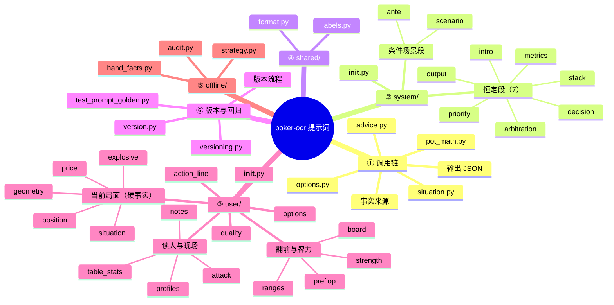

# poker-ocr 提示词思维导图

> lean-zh-2026-11-03.3
>
> 交互版：`docs/提示词模块思维导图.html` · 数据源：`docs/prompt-mindmap.json`

## 结构总览

- **poker-ocr 提示词体系** — lean-zh-2026-11-03.3
  - **① 调用链** — 谁拼提示词、谁调模型
    - `advice.py` — 只负责模型调用与结果
    - `situation.py` — 事实唯一源 build_situation
    - `options.py` — 选项空间：id / 标签 / 金额
    - `pot_math.py` — 几何 / 赔率 / 位置纯计算
    - **事实来源** — ground_truth / 范围 / 画像
    - **输出 JSON** — option + reason(+confidence)
  - **② system/** — 规则：契约 / 优先级 / 决策 / 场景
    - `__init__.py` — 恒定段 + 条件段拼装
    - **恒定段（7）** — 任何牌桌都成立的口径
      - `intro` — 角色与节奏
      - `output` — 输出契约：id + reason
      - `priority` — 五级事实优先级
      - `arbitration` — 规则仲裁：契约 > 场景段 > 恒定段
      - `decision` — 决策顺序：翻前 → 翻后 → 牌力
      - `metrics` — 四二法则 / 范围权益 / 落后
      - `stack` — 后手 / 有效 / 可玩 / SPR
    - **条件场景段** — 按局面追加，条件句优先
      - `ante` — 前注局：死钱与尺度
      - `scenario` — 短码 / 多人池 / 单挑 / 听牌 / 河牌
  - **④ shared/** — 数字格式与中文词表
    - `format.py` — BB 数字唯一口径
    - `labels.py` — 街 / 底池 / 牌型词表
  - **⑥ 版本与回归** — 版本 / golden hash / 复跑
    - `version.py` — PROMPT_VERSION 单一版本源
    - `versioning.py` — CURRENT_ADVICE_VERSION 由 PROMPT_VERSION 派生
    - `test_prompt_golden.py` — prompt hash 锁定
    - **版本流程** — 改文本 → bump → 更新 hash
  - **③ user/** — 事实块：硬事实 → 读牌 → 选项
    - `__init__.py` — 只排顺序与空行
    - **当前局面（硬事实）** — 桌况 / 几何 / 位置 / 价格
      - `situation` — 桌况 / 在局 / Hero / 街道
      - `geometry` — 有效筹码 / SPR / 底池类型
      - `position` — 翻后位置 / 身后待行动
      - `price` — 赔率门槛 / 可争夺底池
      - `explosive` — 炸弹池结构与权益
    - `action_line` — 逐街动作顺序 + 推断标记
    - **翻前与牌力** — 翻前看形态，翻后看牌力
      - `preflop` — 形态 / PFR / 范围结论
      - `strength` — 牌型 / 坚果 / 听牌 / 权益
      - `ranges` — 线路 / 宽度 / 分区 / 谁赢我
      - `board` — 牌面结构 / 转河变化
    - **读人与现场** — 画像 / 桌况 / 观察 / 攻击
      - `profiles` — 逐座位类型 / 范围宽度
      - `table_stats` — 本桌 VPIP / PFR / 弃牌率
      - `notes` — .table_dy 人工观察过滤
      - `attack` — 攻击 / 剥削的单一裁决
    - `quality` — 硬缺口（选项降级）vs 范围缺口
    - `options` — 可选动作 id / 标签 / 金额
  - **⑤ offline/** — 旧英文提示词与策略层，不进 live
    - `strategy.py` — Value directive / Math gate
    - `hand_facts.py` — 旧英文事实块
    - `audit.py` — 复盘审计标签

## Mermaid mindmap

> Mermaid 只保留标题层级；每个模块的作用见上方总览或交互版。
