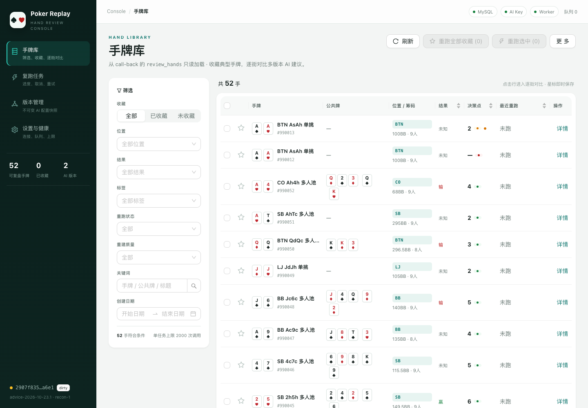
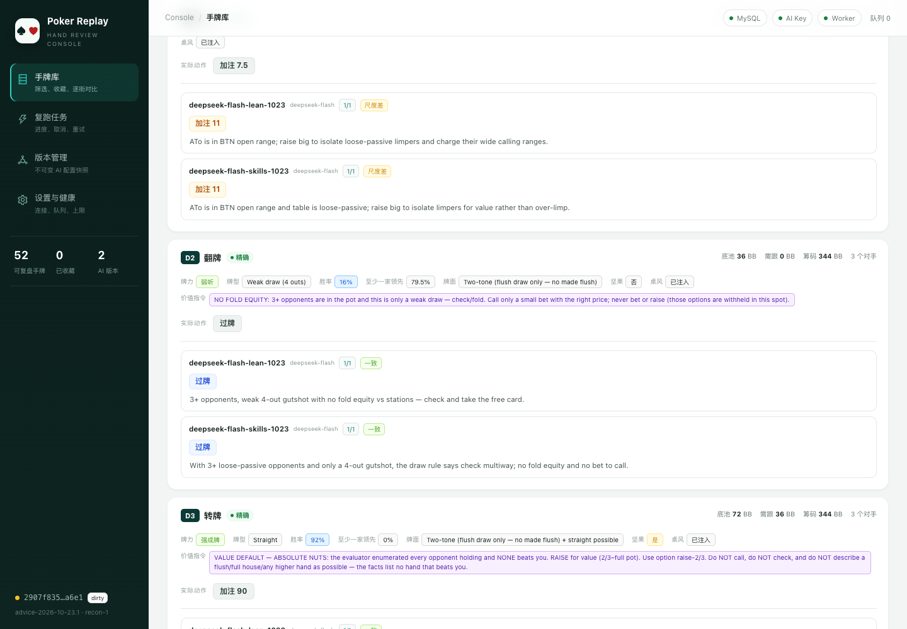
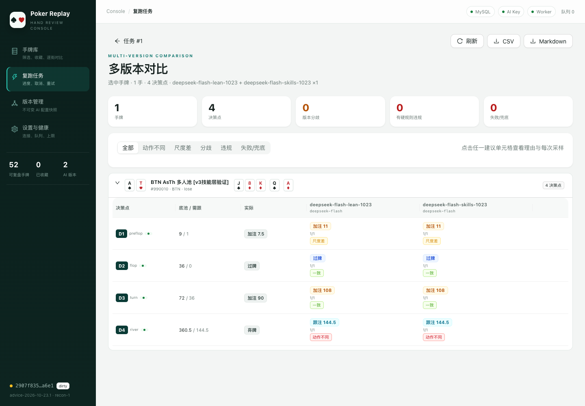
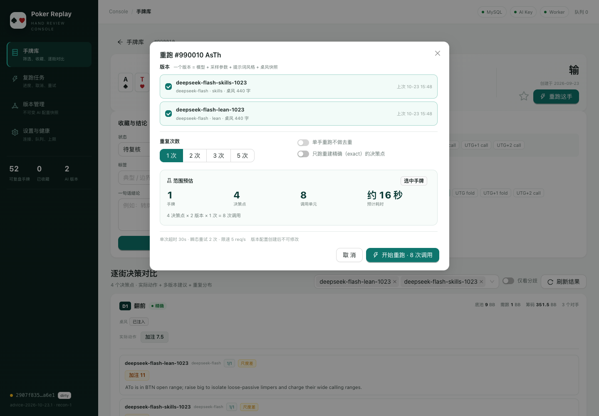

# 手牌复跑控制台（Replay Console）

把「选牌 → 重跑 → 逐街对比多版本 AI → 收藏典型手牌 → 一键全部重跑」做成一个可追溯、可取消、可复现的内部 Web 控制台。

这是按 [`docs/复跑控制台-设计文档.md`](../docs/复跑控制台-设计文档.md) 落地的**独立项目**：

- 后端：FastAPI + PyMySQL，默认 `127.0.0.1:8010`，不加载 OCR 模型；
- 前端：React 18 + Vite + Ant Design 5 + TanStack Query，构建后由 FastAPI 托管；
- 数据库：复用 call-back 的 MySQL 实例；`review_hands` **只读**，新增 `replay_*` 表；
- 重跑引擎：复用父项目 `poker_ocr.advice` 的 `build_situation()` / `advise()`，决策点重建逻辑在本项目的 `replay/decisions.py`；
- 不修改 `call-back` / `call-front` / `api.py` 的任何行为。

> 设计文档的状态是「设计草案 v0.1，本阶段不改代码」；本仓库是在其评审后按 M0–M4 实现的可运行版本。

## 界面预览

| 手牌库 | 逐街多版本决策 |
| --- | --- |
|  |  |

| 多版本对比 | 重跑弹窗 |
| --- | --- |
|  |  |

---

## 1. 已实现功能

| 设计目标 | 实现 |
| --- | --- |
| G1 一个入口看全部可重跑手牌 | 手牌库：按 canonical 归组，同内容多来源显示「同组 N 条」并可展开并列查看；底牌/公共牌/位置/筹码/结果/决策点数/最近重跑/爆炸底池标记；七桶维度筛选、分页、排序、URL 可分享 |
| G2 任意一手牌逐街看多版本建议 | 手牌详情：行动街时间线、D1/D2 锚点、每决策点实际动作 + N 个版本的 option/amount/reason/重复分布 |
| G3 收藏典型手牌并一键全部重跑 | 星标收藏、标签、结论、状态；收藏夹一键重跑；选中多手/当前筛选批量重跑 |
| G4 结果永久可追溯 | 每条结果关联版本快照（模型、采样参数、中文 lean prompt_version、advice_version、桌风 sha、engine commit）与任务快照；旧 `skills`/`lean-rules` 版本只读 |
| G5 重跑不污染生产 | 代码中没有任何 `review_hands` 写入；收藏/标签/结论只写 `replay_marks` |
| G6 失败可恢复 | DB 队列 + 唯一键断点；取消、失败重试、服务重启后 `running` 任务标记失败且已落库结果保留 |

另外实现的功能：

- **重建质量分级**：`exact` / `approx` / `invalid`，页面徽标 + 原因；
- **手牌导入**：手牌库支持导入两种来源——**复盘手牌**（`review_hands` 导出的 JSON/JSONL）和**实时日志手牌记录**（`hands.json` 或 `live.states.jsonl`）；自动识别、预览计数、按内容幂等去重；
- **多来源并列**：同一手牌在复盘/实时/构造三边各有一条源记录时，列表与详情都按 canonical 并列展示，复盘来源的结论只读；
- **从决策点建案例**：详情页每条决策点都可建一条案例（选期望/P0-P2/备注）；案例集页可新建/改名/冻结 revision，seed 由 `tools/import_case_seed.py` 从 `tools/ab_set.json` 幂等导入；
- **评分运行**：选「冻结案例集 × 版本」建 run，创建页先给案例数/P0/预计调用/token/成本，确认后跑；结果落 `replay_runs`/`replay_run_items`，页面给总分（含 95% 区间）、P0 通过率、覆盖率、硬失败清单与逐条明细，可定位到具体案例与当时的选项；中断的 run 标「部分完成」；
- **删除手牌**：列表行内、勾选批量、详情页均可删除；导入手牌软删除（重新导入可恢复），`review_hands` 手牌仅在控制台隐藏，不修改生产业务表；
- **去重**：按手牌内容指纹识别；批量任务默认跳过重复，保留较新的一手；
- **成本与时间预估**：调用单元、预计耗时、超过单任务上限需显式确认；
- **逐 unit 进度**：`done_units / total_units`、分版本完成/失败/兜底/p50；
- **导出**：CSV / Markdown（Markdown 可直接贴进 `docs/复跑-*.md`）；
- **健康检查与设置页**：DB、`review_hands` 可读、AI Key、worker、队列、schema、代码版本；
- **提示词 golden test**：提示词漂移但未 bump `ADVICE_VERSION` 时测试失败。

### 里程碑对照

| 阶段 | 状态 | 说明 |
| --- | --- | --- |
| M0 决策点库 / 迁移 / 列表 API | ✅ | `replay/decisions.py`、`replay/migrations/001_init.sql`、`GET /api/hands` |
| M1 手牌库 / 收藏标签 / 行动街 | ✅ | `/hands`、`/hands/:id` |
| M2 版本管理 / 单手重跑 / 决策卡对比 | ✅ | `/versions`、版本导入/克隆/归档、重跑弹窗、逐街对比 |
| M3 批量任务 / 进度 / 取消 / 重试 / 预估 | ✅ | `/jobs`、任务详情、worker、`POST /api/runs` |
| M4 对比筛选 / 导出 / 质量徽标 / 恢复 | ✅ | 对比视图、CSV/Markdown、保留策略、重启恢复 |
| M5 live log / 线上建议基线 / 多用户 | 🟡 部分 | 已支持 live 自动 outbox 入库、线上建议 prompt 快照、stored prompt baseline、手牌集/成对复盘；多用户鉴权未做 |

---

## 2. 快速开始

### 2.1 依赖

父项目已经提供 Python 3.12 + FastAPI + poker_ocr 依赖。控制台额外需要 PyMySQL：

```bash
cd ..                       # poker-ocr 仓库根
nv pip install -r replay-console/requirements.txt
```

（`nv pip` = `.venv` 的 pip；这个 venv 是 uv 建的、没有 pip 时自动改走 `uv pip`。）

前端：

```bash
cd replay-console/replay_web
pnpm install
pnpm build                  # 生成 dist/，由 FastAPI 同源托管
```

> `pnpm-workspace.yaml` 已允许 esbuild 的安装脚本，并关闭了 pnpm 的交互式
> `confirmModulesPurge`；如果使用更老的 pnpm 仍提示 `NO_TTY`，在命令前加 `CI=true`。

### 2.2 配置

```bash
cd replay-console
cp .env.example .env
```

最少需要：

- MySQL：默认自动从 `poker-ocr/.env`、`../call-back/.env` 补齐 `DB_*`；也可以在本项目 `.env` 显式覆盖。
- AI Key：在 `poker-ocr/.env` 配置 `AI_SERVER_API_KEY` / `AI_SERVER_BASE_URL` / `AI_SERVER_MODEL`。
- `REPLAY_HAND_USER_ID=0`：读全部 `review_hands`；大于 0 时只读该用户。

启动：

```bash
# 开发
../nv -m uvicorn replay_api:app --host 127.0.0.1 --port 8010 --reload

# 或
./start.sh
```

打开 <http://127.0.0.1:8010>。

首次启动会自动迁移 `replay_*` 表（`REPLAY_AUTO_MIGRATE=1`）。因为目标 MySQL 新建连接握手要 6–8 秒，启动时会并发预热 3–4 条连接；之后查询都在几十毫秒级。

### 2.3 前端开发态

```bash
cd replay-console/replay_web
pnpm dev
# http://127.0.0.1:5173，/api 代理到 :8010
```

生产/本机使用：`pnpm build` 后刷新 <http://127.0.0.1:8010> 即可，不需要单独起前端服务。

---

## 3. 目录结构

```text
replay-console/
├── replay_api.py              # uvicorn / python replay_api.py 入口
├── start.sh
├── requirements.txt
├── .env.example
├── replay/
│   ├── config.py              # 分层 .env、运行配置、git 版本
│   ├── db.py                  # PyMySQL 连接池 + 迁移
│   ├── decisions.py           # review_hands → 决策点 / 指纹 / 质量 / 快照序列化
│   ├── importer.py            # 复盘 / 实时日志手牌 → 统一内部行
│   ├── versioning.py          # 版本不可变配置哈希 / advice_version / 桌风
│   ├── engine.py              # 规则审计、动作分类、模型调用重试、重复分布聚合
│   ├── specs.py               # 场景期望 §4.1 词表 / 校验 / revision diff（纯逻辑）
│   ├── scoring.py             # 五维打分 / 六类硬失败 / 聚合与 Wilson 区间（纯逻辑）
│   ├── run_repository.py      # replay_runs / replay_run_items 读写
│   ├── run_worker.py          # 评分运行队列 worker：执行单元 + 评分 + 收尾
│   ├── judge.py               # LLM judge（#58）：要点逐条判定 / evidence / 改判叠加（纯逻辑 + 单次调用）
│   ├── canonical.py           # canonical 手牌归组：同内容判定 / content_group / primary（纯逻辑）
│   ├── repository.py          # review_hands 只读 + 导入手牌 + replay_* 读写
│   ├── service.py             # 手牌库/导入/详情/版本/任务/对比/导出/健康
│   ├── runner.py              # DB 队列 worker + 线程池 + 断点恢复
│   ├── worker.py              # 可选独立 worker 进程
│   ├── api.py                 # FastAPI 路由 + SPA 托管
│   ├── cases.py               # 案例桶推导 / 最具体 spec 选择 / 案例集统计
│   ├── schemas.py             # 请求体
│   └── migrations/001_init.sql … 013_score_runs.sql, 014_judge_overrides.sql
├── replay_web/                # React + Vite + AntD
└── tests/                     # 决策点 / 引擎 / 版本 / API / 提示词 golden
```

数据表：`replay_versions`、`replay_jobs`、`replay_job_hands`、`replay_decisions`、`replay_results`、`replay_marks`、`replay_imported_hands`、`replay_import_batches`、`replay_hand_deletions`、`replay_spot_specs`、`replay_canonical_hands`、`replay_hand_sources`、`replay_case_sets`、`replay_cases`、`replay_runs`、`replay_run_items`、`replay_judge_overrides`、`replay_judge_override_log`、`replay_schema_migrations`。全部是逻辑外键，不修改 `review_hands`。

canonical 手牌：一手牌可以在复盘（`review`）、实时（`live`）、构造（`synthetic`）三边各有一条源记录（`replay_hand_sources`），同内容（底牌相同 + 公共牌相同 + 发生时间差 ≤ 30 分钟）的源记录挂到同一个 `replay_canonical_hands.id` 上，并列保存、互不覆盖。`primary_source` 默认 `review > live > synthetic`，可人工切换；`content_group` 是 `sha1(底牌|公共牌|日期)` 的归组键。归组规则在 `replay/canonical.py`（纯逻辑），SQL 读写与 primary 切换在 `repository.CanonicalHandRepository`（逐条自动提交，不开显式事务；中途失败只会留下无源记录的空 canonical 行，不影响读路径）。案例表（`replay_case_sets`、`replay_cases`）已接最小写路径：详情页每个决策点可建案例，默认落在「待整理」案例集；案例集页、批量建案例、冻结与 seed 已接：冻结后只读（改内容要建新 revision），seed 按 (case_set, canonical, decision_key) 幂等，spec 落在 `replay_spot_specs`。运行四张表：`replay_runs`/`replay_run_items` 已由评分运行写入（见 §4.5）；`replay_judge_overrides`（人工改判，聚合优先、不覆盖机器原值）与 `replay_judge_override_log`（逐次改判留痕：谁/何时/从什么改成什么）随 #58 一起接上。评分运行与旧 job 链路（`replay_jobs`/`replay_results`）互不干扰。

---

## 4. 关键口径

### 4.1 一个 AI 版本

```text
模型 + 接口地址 + 采样参数 + 提示词风格 + advice_version
+ reconstruct_version + 桌风快照
```

- 版本创建后配置字段**不可修改**，只能改名称/备注/归档；改配置要克隆。
- `config_hash` 不含 `engine_commit`（仅追溯），但包含 `advice_version`、`reconstruct_version`、桌风 sha。
- 版本只有在 `advice_version` / `reconstruct_version` 与当前代码一致、且 Key 环境变量存在时才能创建任务；旧版本只用于看历史结果。
- 桌风在创建版本时冻结；worker 不再读 `.table_dy`。

### 4.2 决策点身份与手牌指纹

- 身份：`(hand_id, hand_fingerprint, reconstruct_version, street, seq)`。
- 指纹只包含会影响建议的字段（底牌/公共牌/位置/筹码/盲注/对手/行动线），改标题、输赢金额、复盘结论**不会**让已有结果失效。
- 同一街 hero 可能行动两次，`seq` 是整手牌内的序号，不是街序号。
- `backfilled`：线上录制偶发英雄动作没进 timeline，但 advice 行完整记着当时的 pot/to_call。这类点按 advice 回填成决策点（`backfilled=true`、`actual=null`、质量 `approx`、warning 记「英雄动作缺录」），**绝不编造动作**。只补整手最后一个英雄动作之后的点，已有决策点的 `seq` 不因此改变；advice 的 pot/to_call 与行动线对不上（容差 0.05）则丢弃并记 warning。

### 4.3 重建质量

- `exact`：首街是 `preflop` 且行动线完整（下注/加注金额齐全、没有旧聚合 actor），底池可以从盲注 + 行动精确重建；或每街都有 `potStartBb`。
- `approx`：手牌从翻后开始且缺翻前/起始底池；对手位置/筹码缺失；旧数据 `actor=villain/other`；下注金额缺失；中间某街缺 hero 动作但后面 hero 还有决策；线上 advice 回填的决策点（英雄动作缺录，`actual` 未知）。
- `invalid`：`bb<=0`、底牌不是 2 张、行动线为空、没有 hero 决策点。

批量任务可以只跑 `exact` 决策点（弹窗里的「只跑重建精确」）。

### 4.4 执行

- DB 队列 + 单 worker + `REPLAY_WORKERS` 个 unit 线程；默认一次只跑一个任务。
- 每个 unit 的结果先落 `replay_results`，唯一键 `(job_id, decision_id, version_id, repeat_index)` 是天然断点。
- 单次超时 30s；超时/429/5xx/连接错误退避重试 2 次；400、鉴权失败、返回非法选项不重试。
- `advise()` 的 `source=fallback` 会落库并标记「兜底」，但**不**计入模型一致率分母；未捕获异常记 `source=error`，计入 `failed_units`。
- 取消是协作式的；服务重启时 `running` 任务标记失败，已落库结果保留，可点「重试失败/未完成」。

---

### 4.5 评分运行（#56 / #57）

一次 run = **一个冻结案例集 revision × 一组冻结 spec revision × 一个版本 × 判定版本 × 重建版本**，五个都写进 `replay_runs.config_snapshot`；案例在创建时按「维度最多者胜、平手取最近创建」写死 `spec_id`，run 跑完也不会因为 spec 后续编辑而改变口径。

单案例五维打分（`replay/scoring.py`，纯函数）：

| 维度 | 权重 | 口径 |
| --- | --- | --- |
| 动作 `s_action` | 35 | 建议动作 ∈ spec 的 `allowed_actions` 且 ∉ `forbidden_actions` 得 1；与英雄实际动作的比较只作展示，实际动作是 `未知动作`（回填点/缺录）时记空、不算分歧 |
| 尺寸 `s_size` | 15 | `fold/check/call` 恒 1；`bet/raise/allin` 落带内 1，带外 `max(0, 1 - 距离/带宽)`（带宽 0 用 0.1 兜底）；多条带取最小值；`pot<=0` 时底池比例带不参与。BB 带直接用 `option_amount`（它本来就是 BB），不再除大盲 |
| 依据 `s_reason` | 30 | 命中 `required_points` 的加权和 / 总权重；要点为空时退化为「理由是否提到该动作」0/1 |
| 事实 `s_fact` | 15 | `1 - 错误事实项/引用事实项`；没引用事实记 1（fail open） |
| 稳定 `s_stable` | 5 | 同案例 3 次建议动作的一致率；没抽样时整维不进分母 |

`score = Σ W·s / Σ W`；命中硬失败封顶 40。硬失败六码：`HF_OPTION`（option 不在该决策点选项里）、`HF_FALLBACK`（不是模型给的建议）、`HF_FORBIDDEN_ACTION`、`HF_FORBIDDEN_POINT`、`HF_HALLUCINATION`（把 facts 里没有的具体事实当依据）、`HF_ERROR`（调用异常）。事实说错只扣 `s_fact`，不算硬失败。

聚合：总分取「重复 0 次」的案例均值，P0 通过率 = (P0 且无硬失败 且 `s_action=1`) / **本次 run 的 P0 案例总数**（没跑到/没出分的 P0 也算分母，否则通过率虚高），覆盖率 = 达到 `FREQ_MIN_N=15` 样本的桶数 / 有 active spec 的桶数（按 spec 的桶标签去重，空桶不计；分母是本次 run 开始时全部 active spec 的桶，不是恰好被冻结到的那些）。比例类给 Wilson 95% 区间，均值给正态近似；页面同时显示 n 与区间。

**偏差热点（#59）**：`GET /api/score-runs/{id}/hotspots` 把一次运行按 **spec 桶**聚合（spec 的 bucket/freq 在建 run 时已冻结，同桶不同 spec 不混算），每行同时给 `n`、均分与 95% 区间、硬失败数与 Wilson 区间、频率「实际 vs 目标带」；`severity = dev × √n`，`dev` 有可判定频次时按「离带中点几个半带宽」算、否则按 `(100−均分)/50`，都封顶 3。样本 `n < FREQ_MIN_N(15)` 的桶标 `insufficient`，不进频率达成率的分子/分母；总览的达成率同样带 Wilson 区间。页面 `/hotspots` 下钻到「桶 → 案例（只看 `repeat=0`、硬失败优先、分数升序）→ 条目」，并可从热点建/改 spec（预填七维桶；新建默认生效，否则案例按桶匹配不到它）、按桶从存档补样进案例集（同集 + 同一手牌 + 同一决策点幂等）。每行的偏差会标出口径（频次口径 / 均分口径），口径切换不隐藏。不做告警、不做 CI 卡点。

**LLM judge（#58）**：run 路径先用判定模型逐条判 `required_points` / `forbidden_points`（温度 0，`judge_version = llm-j1:<模型>` 冻结进 `config_snapshot.judge`），再走同一套五维合成；`s_reason` 用要点加权和，`s_fact` 用引用/缺失事实，`HF_HALLUCINATION` / `HF_FORBIDDEN_POINT` 在 run 路径真正生效。每条硬失败把 evidence 落进 `judge_json`：引用的原句 `quotes`、facts 里缺失的项 `missingFacts`、命中的禁令 `forbiddenPoints` / `forbiddenActions`，页面据此展示「为什么判它错」。judge 自己失败（超时、回复不是合法 JSON）时 fail open：退回 #57 的退化口径（`reasonMode: action-support`，不伪造硬失败，`judge_json.status=error` 且带 error 文本）。判定模型要求与被测模型不同、走最强档：`REPLAY_JUDGE_MODEL`（默认 `deepseek-v4-pro`）、`REPLAY_JUDGE_BASE_URL`（缺省回落 `AI_SERVER_BASE_URL`）、`REPLAY_JUDGE_API_KEY_REF`（默认 `AI_SERVER_API_KEY`）、`REPLAY_JUDGE_TIMEOUT`（默认 30 秒）、`REPLAY_JUDGE_THINKING`；不合规时创建页显示原因、`create_score_run` 直接 409 `JUDGE_NOT_READY`。人工改判写 `replay_judge_overrides`（唯一键 run+case，带 `actor` / `note` / `updated_at`），原始 `replay_run_items.score` 与 `judge_json` 一个字不动，聚合时优先取改判分；每次改判/撤回都追加一行 `replay_judge_override_log`（before/after）。抽屉里可看逐条判定与 evidence、保存/撤回改判，并可「重判（不写库）」比对一致性。语义口径见 `replay/judge.py` 顶部。

采样与中断：每个案例跑 1 次，`priority=0` 的案例额外再跑 2 次（固定样本，不随机抽）；调用次数 = 案例数 + P0 数 × 2。取消是协作式的：已完成的案例照常计分，**没开跑就取消的单元不算「已完成」**（进度不会跳到 N/N），run 标 `partial` 并在 `error_msg` 里写「完成 X/Y 个案例；已按要求中断」；服务重启时 `running` 的 run 会被标成 `partial`，不冒充成功。案例缺决策点、或冻结的 spec 已被删时，不静默跳过也不换 spec：落一条 `source=error` 的 run_item（`HF_ERROR`，errorMsg 写明原因），run 因有 error 标 `partial`。

成本估算：`calls × token`，token 优先用该版本在 `replay_results` 的历史均值，没有就用默认 2000 in / 300 out；单价来自 `REPLAY_PRICE_TABLE`（JSON：`{"<model>": {"in": 元/百万, "out": 元/百万}}`），没配就显示「未知单价」而不是编一个数；配了但格式错（坏 JSON、缺 `in`/`out`、负数）启动即报错，不静默当没配。预计调用超过 `REPLAY_MAX_CALLS_PER_JOB`（默认 2000）时不硬拒：创建页要求勾选「我知道会超上限」后带 `confirmLarge` 提交，否则 409 `RUN_TOO_LARGE`。

---

## 5. API 速查

| 方法 | 路径 | 说明 |
| --- | --- | --- |
| GET | `/api/meta` | 手牌数、收藏数、版本数、默认版本/重复、健康摘要 |
| GET | `/api/health` | DB、review_hands、AI Key、worker、队列、schema |
| GET | `/api/hands` | 按 canonical 归组的手牌库；`total` 是组数、`handTotal` 是可见源手牌数。筛选/分页/排序：`favorite`, `source`(review/live/synthetic), `position`, `result`, `tag`, `hasRun`, `hasCase`, `flags`, `minScore`, `quality`, `keyword`, `dateFrom`, `dateTo`, `notRunDays`, 七桶 `street`/`position_bucket`/`hand_tier`/`board_texture`/`pot_type`/`facing`/`opponent_profile`, `page`, `pageSize`, `sort`, `order`；每行带 `sources[]`、`groupSize`、`buckets`、`caseCount` |
| POST | `/api/hands/import` | 导入复盘/实时手牌；先 `dryRun=true` 预览，再落库 |
| GET | `/api/imports` | 最近导入批次（来源、计数、状态、错误） |
| GET | `/api/hands/{id}` | 详情 + 行动街 + 决策点元数据；`id` 可传 canonical id 或任一源手牌 id，返回 `canonical`、`sources`（含只读复盘结论）、`cases` |
| GET | `/api/hands/{id}/comparison` | `versionIds=1,2&jobId=...` 多版本对比（同样接受 canonical id） |
| PATCH | `/api/hands/{id}/mark` | 收藏/标签/状态/结论 |
| DELETE | `/api/hands/{id}` | 删除单只手牌（导入手牌软删除；review_hands 仅隐藏） |
| POST | `/api/hands/delete` | 批量删除，body `{"handIds":[1,2]}`，最多 1000 手 |
| POST | `/api/cases` | 从决策点建案例：`{canonicalId, decisionKey:"flop:2", specId, caseSetId?, priority?, overrides?, note?}`；返回 `{created, case}`，已存在则返回已有案例 |
| GET | `/api/case-sets` | 案例集列表（`name` 精确过滤、`limit`）；每行带 `caseCount`/`p0Count`/`p0Ratio` |
| POST | `/api/case-sets` | 新建案例集 v1：`{name, purpose?}`；同名再建报 `CASE_SET_EXISTS`（改内容走 revisions） |
| GET | `/api/case-sets/{id}` | 详情：`items`（案例 + 手牌摘要 + 七桶）+ `stats`（P0 比例、按优先级/街/桶） |
| PATCH | `/api/case-sets/{id}` | 改名/改用途；已冻结 409 |
| POST | `/api/case-sets/{id}/freeze` | 冻结该 revision；之后增删改一律 409 并提示「建新版本」 |
| POST | `/api/case-sets/{id}/revisions` | 从当前（含已冻结）复制成下一个 revision，可带 `{name?, purpose?}` |
| POST | `/api/case-sets/{id}/cases` | 批量建案例 `{cases:[{canonicalId, decisionKey, specId, priority?, note?}]}`；失败项进 `skipped`，不整批回滚 |
| PATCH | `/api/case-sets/{id}/cases/{caseId}` | 改案例的 spec/优先级/状态/备注（冻结后 409） |
| DELETE | `/api/case-sets/{id}/cases/{caseId}` | 删案例（冻结后 409） |
| POST | `/api/case-sets/{id}/hand-cases` | 整手全建 `{canonicalId, priority?}`：每个决策点自动挑最具体的 active 期望 |
| GET | `/api/case-sets/{id}/candidates` | 按桶找「可补样」决策点（#59）：`street`/`position_bucket`/… 单值或逗号多值、`limit`/`offset`；带手牌摘要、`inSet`（已在集内）与自动匹配到的 active `specId` |
| POST | `/api/case-sets/{id}/sample` | 按桶补样 `{bucket:{维度:[值]}, count?, priority?}`，按时间倒序抽决策点 |
| POST | `/api/case-sets/seed` | 把 `tools/ab_set.json` 导成 seed 案例集：`{path?, setName?, dryRun?}`；幂等，`dryRun` 只预演 |
| GET | `/api/score-runs/meta` | 创建页字典：冻结案例集（带计划调用数）、版本（带 blockers/runnable）、判定/重建版本、单价模型 |
| POST | `/api/score-runs/estimate` | 预估 `{caseSetId, versionId}` → 案例数/P0/调用次数/token/成本，以及 `runnable` 与缺 spec 的案例 |
| GET | `/api/score-runs` | 评分运行列表（`caseSetId`/`status`/`limit`） |
| POST | `/api/score-runs` | 建 run：`{caseSetId, versionId}`；未冻结 409、缺 spec 422、超上限 422 |
| GET | `/api/score-runs/{id}` | 单次 run：状态、总分/P0/覆盖率/metrics、config 快照 |
| POST | `/api/score-runs/{id}/cancel` | 请求中断（协作式，跑完当前单元就停，run 标 partial） |
| GET | `/api/score-runs/{id}/items` | 逐条结果（`only=hardfail`、`specId` 按桶下钻、`repeat` 只看首次建议、`sort=score` 硬失败优先且按改判后的有效分升序（响应带 `total`/`truncated`）、`limit`/`offset`），带计数摘要 |
| GET | `/api/score-runs/{id}/hotspots` | 偏差热点（#59）：按 spec 桶聚合的 n / 均分+CI / 硬失败率+CI / 频率达成 / `severity`，外加总览 `summary` |
| GET | `/api/score-runs/{id}/items/{caseId}/{repeatIndex}` | 单条明细：建议、五维分、judge 证据、当时的 options、facts、prompt |
| GET | `/api/versions` | 版本列表（`includeArchived=1`） |
| POST | `/api/versions` | 新建 |
| POST | `/api/versions/import-env` | 从当前 `.env` + `.table_dy` 导入 |
| POST | `/api/versions/{id}/clone` | 克隆 |
| PATCH | `/api/versions/{id}` | 改名/备注/归档 |
| POST | `/api/runs/preview` | 范围解析与调用/耗时预估 |
| POST | `/api/runs` | 创建任务；超过上限需 `confirmLarge=true` |
| GET | `/api/runs` | 任务列表 |
| GET | `/api/runs/{id}` | 进度、逐手、失败、分版本统计 |
| GET | `/api/runs/{id}/results` | 按手牌分组的对比结果（`only=diff/size/diverged/violation/error`） |
| POST | `/api/runs/{id}/cancel` | 取消 |
| POST | `/api/runs/{id}/retry-failed` | 只重跑失败/未完成手牌 |
| GET | `/api/export?jobId=...&format=csv|markdown` | 导出 |
| GET | `/api/specs/meta` | 期望库词表（七个桶维度、动作、尺度单位、状态） |
| GET | `/api/specs` | 期望列表（每个名字取最新 revision；`status` 取 active / draft，`q` 关键词） |
| POST | `/api/specs` | 新建期望 = 插入 v1（`status` 默认 draft） |
| GET | `/api/specs/{id}` | 单个 revision |
| POST | `/api/specs/{id}/revisions` | 从最新 revision 派生新版本；旧行只读 |
| PATCH | `/api/specs/{id}` | 只改 `status`（生效会退回同名旧 active） |
| DELETE | `/api/specs/{id}` | 只删最新且非生效的 revision |
| GET | `/api/specs/{id}/history` | 同名全部 revision（最新在前） |
| GET | `/api/specs/{id}/diff?against=` | 与上一版（或指定 revision）的变更清单 |

错误统一为：

```json
{"error": {"code": "VERSION_STALE", "message": "…", "detail": {}}}
```

常见错误码：`HAND_NOT_FOUND`、`INVALID_CASE`、`DECISION_NOT_FOUND`、`CASE_SET_NOT_FOUND`、`CASE_SET_FROZEN`、`CASE_SET_EXISTS`、`INVALID_CASE_SET`、`SPEC_REQUIRED`、`SEED_HAND_MISSING`、`SEED_CANONICAL_MISSING`、`SEED_DECISION_MISSING`、`INVALID_SEED_PATH`、`VERSION_NOT_FOUND`、`VERSION_ARCHIVED`、`VERSION_STALE`、`VERSION_NOT_RUNNABLE`、`CASE_SET_NOT_FROZEN`、`CASE_SET_EMPTY`、`CASE_NO_SPEC`、`RUN_NOT_FOUND`、`RUN_ITEM_NOT_FOUND`、`INVALID_RUN`、`RUN_TOO_LARGE`、`INVALID_VERSION_CONFIG`、`AI_KEY_MISSING`、`TOO_MANY_CALLS`、`JOB_QUEUE_FULL`、`JOB_NOT_CANCELABLE`、`DB_UNAVAILABLE`、`EXPORT_EMPTY`。

期望库错误码：`INVALID_SPEC`、`INVALID_SPEC_SCHEMA`、`INVALID_SPEC_BUCKET`、`INVALID_SPEC_DIMENSION`、`INVALID_SPEC_VALUE`、`INVALID_SPEC_ACTION`、`INVALID_SPEC_SIZING`、`INVALID_SPEC_FREQ`、`INVALID_SPEC_POINT`、`INVALID_SPEC_STATUS`、`INVALID_SPEC_DIFF`、`SPEC_NOT_FOUND`、`SPEC_NAME_TAKEN`、`SPEC_NAME_IMMUTABLE`、`SPEC_NOT_LATEST`、`SPEC_ACTIVE`、`SPEC_REVISION_CONFLICT`。

### 5.1 导入手牌

页面入口：手牌库右上角 **导入手牌**。支持拖入文件或直接粘贴，先「解析预览」再「确认导入」。

请求示例：

```bash
curl -s http://127.0.0.1:8010/api/hands/import \
  -H 'Content-Type: application/json' \
  -d '{"format":"auto","dryRun":true,"dedupe":true,"content":"<文件原文>"}'
```

两种输入：

| 格式 | 典型文件 | 识别依据 | 说明 |
| --- | --- | --- | --- |
| 复盘手牌 | `review_hands` 导出的 JSON / JSONL | `heroCards` / `hero_cards` + `streets[].actions[].actor` | 兼容 camelCase 与 snake_case；`streets` 可以是 JSON 字符串 |
| 实时日志 | `hands.json`、`live.states.jsonl` | `type=hand`、`hero_cards` 数组、`blinds`、`streets[].actions[].seat_id` | JSONL 会自动跳过 `state`/`session_start`；默认跳过 `partial` 和翻后接管手牌。新版记录还带 `hero_stack_bb` / `start_stacks`，直接用于重建筹码约束 |

导入选项：

- `dryRun=true`：只解析、分析、去重计数，不写库；
- `dedupe=true`（默认）：同一来源 + 相同内容更新原记录；库中已有相同内容（包括 `review_hands`）时跳过；
- `onlyExact=true`（默认）：只导入重建质量为 `exact` 的手牌；`approx` 是推算值，默认跳过（预览里计为「非精确」），需要时在导入弹窗取消勾选；
- `allowInvalid=false`（默认）：跳过缺底牌/行动线/bb 的不可重跑手牌；
- `includePartial` / `includeMidHand`：仅实时日志，保留截断手牌/翻后接管手牌。

落库后，导入手牌使用 `1e12` 起的独立 id 段，和 `review_hands` 一起出现在手牌库；来源筛选按 canonical 来源分为 **复盘 / 实时 / 构造**，同内容多来源在列表显示「同组 N 条」、详情并列。收藏、决策点、重跑结果与原生手牌共用同一套 `replay_*` 表。

详细字段映射与样例见 [`docs/导入手牌-格式说明.md`](docs/导入手牌-格式说明.md)。

### 5.1.1 实时 outbox 自动入库

live 默认把**已结束**手牌写进 `data/hand_outbox/pending/`（一手一个 JSON，
原子写；`--no-hand-outbox` 关闭）。手牌库在线时用工具同步：

```bash
nv tools/sync_hand_outbox.py \
  --url http://127.0.0.1:8010 --token "$REPLAY_TOKEN"
```

它优先调用 `POST /api/hands/ingest`（结构化，直接吃 `HandRecord v2`），
旧服务端 404 时自动回退到 `/api/hands/import`。成功才移到 `sent/`；失败留在
`pending/` 并记次数，达到 `--max-failures` 后进 `failed/`，可 `--retry-failed`。

live 现在默认内嵌 `HandIngestWorker`（`HAND_INGEST_MODE=auto`），手牌结束后
自动 POST，不需要手动跑上面的工具；手牌库离线时留在 pending，恢复/下次启动
自动补。可用 `HAND_INGEST_URL` / `HAND_INGEST_TOKEN` / `HAND_INGEST_INTERVAL`
调整。**改了 Python 代码后要重启 live 和 replay-console**，旧进程不会加载新
路由/新字段。

`replay_live_advices` 新增了 `prompt_system`、`prompt_user`、`prompt_sha256`、
`raw_response`、`reason_full`、`facts_json`、`model_params_json` 等列：
手牌详情底部可跳到回放页，在决策点打开 **Prompt Inspector** 看原文；
A/B 的 baseline 也可以用这份线上 prompt 做 `stored` 重放。

结构化 ingest 会额外写三张表：

| 表 | 内容 |
| --- | --- |
| `replay_hand_players` | 每手每个座位的 `player_key/name/position/is_hero`，支持按玩家检索 |
| `replay_live_advices` | 线上实际给出的建议 + `action_index` + `context_json`（桌况/画像快照）+ 实际动作/bucket |
| `replay_decision_marks` | 逐决策点 `good/bad/unsure` + 标签 + 备注（复盘用） |

幂等键是 `(user_id, source, external_uid)`；补了 advice/context 不会重复入库。
手牌列表新增「深挖」列（`review_score` + 标记），可按 `flags` / `minScore` 筛选；
左侧 **手牌集** 可把选中的手牌冻结成回归集，实验详情 → **成对复盘** 逐决策点
看 A/B 理由并记 A/B/same/unsure。

版本新增 `contextMode` / `tableStatsMode`（`none/snapshot/recompute`）：
`snapshot` 时重跑会注入 **线上那一刻** 的 `opponent_reads` / `table_stats`，
A/B 才是同一上下文；`none` 保持旧行为，可做「有画像 vs 无画像」的对照。

### 5.1.2 离线 A/B（后端）

实验 = 冻结手牌集 + baseline/variant 两个版本 + dev/holdout 切分。切分按
`sha256(实验名:hand_fingerprint)` 落在**手牌级**，同一手的翻前/翻后不会分到
两边；两边至少各有一手。创建时冻结 `hand_id + fingerprint`，跑完不漂移。

```bash
# 1) 创建（scope=hands 或 filter）
curl -s http://127.0.0.1:8010/api/experiments -H 'Content-Type: application/json' -d '{
  "name":"ctx-snapshot-vs-none",
  "hypothesis":"注入当前桌统计能提高一致率",
  "baselineVersionId":1,
  "variantVersionId":2,
  "scope":"filter",
  "filter":{"source":"live"},
  "devRatio":0.7,
  "repeat":3
}'

# 2) 跑（生成普通 replay_job，带 experiment_id）
curl -s -X POST http://127.0.0.1:8010/api/experiments/1/run   -H 'Content-Type: application/json' -d '{"confirmLarge":true}'

# 3) 看结果（可加 ?split=dev 只看开发集）
curl -s 'http://127.0.0.1:8010/api/experiments/1/results?split=dev'
```

结果按版本返回 `n`、`bucket`（一致/尺度差/动作不同/未知动作/error）、`source`、
`violations`、`scored`、`unknown`、`agreement`，以及人工复盘 `review`（good/bad/unsure）。
实际动作缺录（线上 timeline 漏采、advice 回填的决策点）记 `未知动作`，不进
`agreement` 的分母：`agreement = 一致 / (n - unknown)`，`scored == 0` 时为 `null`。
逐决策点标记：

```bash
curl -s -X PATCH http://127.0.0.1:8010/api/decisions/123/mark   -H 'Content-Type: application/json'   -d '{"verdict":"bad","tags":["河牌薄价值"],"note":"对手是跟注站"}'
```

前端入口：左侧 **A/B 实验** → 新建（选 baseline/variant、来源、dev 比例、重复次数）
→ 运行 → 按 dev/holdout 看每版本 `n/agreement/bucket/违规`；手牌详情每个决策点
右侧 **复盘** 可记 `good/bad/unsure` + 标签 + 备注，A/B 结果页会汇总 review。
版本管理里新增 `contextMode` / `tableStatsMode` 两个下拉，新版本默认 `snapshot`。

**口径提醒**：`agreement` 只是「与人类实际动作一致」，不是正确率；结论要结合
人工 review、violation 和样本数（n<30 手不要写显著）。`未知动作` 占比高说明
录制侧在丢英雄动作，先修数据再看一致率，别把它当成模型变差。

### 5.2 删除手牌

入口：列表行内「删除」、勾选底部「删除选中」、详情页「删除这手」。

删除语义刻意分成两种，避免控制台写生产业务表：

| 手牌来源 | 删除行为 | 能否恢复 |
| --- | --- | --- |
| 导入手牌（复盘/实时） | `replay_imported_hands.deleted_at` 软删除；收藏、决策点、历史结果保留 | 重新导入同一份内容会更新并恢复该记录 |
| `review_hands` 手牌 | 写 `replay_hand_deletions`，列表/详情过滤；**不修改** `review_hands` | 删除对应隐藏记录即可（需手工 SQL） |

批量删除接口：

```bash
curl -s http://127.0.0.1:8010/api/hands/delete \
  -H 'Content-Type: application/json' \
  -d '{"handIds":[1000000000002, 990052]}'
```

返回 `{requested, deleted, imported, reviewHidden, missing}`。已删除手牌不会出现在手牌库、收藏、筛选和重跑范围中；历史任务的结果行仍保留用于追溯。

---

## 6. 测试

```bash
cd replay-console
CI=true ../nv -m pytest tests -q
```

覆盖：

- 决策点重建：preflop 起始 exact、bb=0 invalid、翻后起始 approx、旧 actor approx、缺 hero 动作 approx、指纹排除标题/输赢、快照 JSON roundtrip；
- 引擎：preflop 尺度容差、`open-4` 这类 option id 的 kind 映射、重复分布、fallback 不计入一致率、对比数据结构；
- 版本：配置哈希稳定性/敏感性、Key 缺失/归档/旧语义 blocker、public view 不泄露 Key；
- 导入：复盘 JSON/JSONL、实时 `hands.json`/原始日志、自动识别、partial/中途接管过滤、去重/更新/不可重跑、预览不写库；
- 删除：单删/批量删除、导入手牌软删除、review_hands 仅隐藏、missing 返回、参数校验；
- API：meta、校验错误、收藏、创建任务、错误 envelope、导出头、导入与删除路由；
- 期望库：§4.1 校验（未知维度/非法单位/`min_n` 门槛字段 fail fast）、规范化、revision diff；
- 期望库版本语义：保存即新 revision、旧 revision 只读、只能从最新派生、单 active 互斥、只删最新草稿；
- 提示词 golden：改动提示词但未 bump `ADVICE_VERSION` 时失败。

前端类型检查与构建：

```bash
cd replay_web
CI=true pnpm typecheck
CI=true pnpm build
```

---

## 7. 运维

- 日志：`replay-console/logs/replay-console.log`（10MB 轮转 3 份）；结构化字段由 logger 输出，不打印 Key/完整 prompt。
- 独立 worker（可选）：

  ```bash
  # API 进程
  REPLAY_WORKER_ENABLED=0 ../nv -m uvicorn replay_api:app --host 127.0.0.1 --port 8010
  # worker 进程
  ../nv -m replay.worker
  ```

- 默认只绑 `127.0.0.1`。对局域网开放时设置 `REPLAY_TOKEN`；非本机请求必须带 `Authorization: Bearer <token>`。
  前端会从浏览器 `localStorage.replay_token` 读取并附加这个头；内部局域网使用时先执行
  `localStorage.setItem('replay_token','...')`，或在前置代理里统一注入。
- 保留策略：`REPLAY_STORE_PROMPTS=0` 不存 prompt/raw；`REPLAY_RETENTION_DAYS` > 0 时启动会清理超期结果的 prompt/raw（不删结果行）。
- 备份：`replay_*` 与业务库同实例，跟随现有备份策略。

---

## 8. 与设计文档的差异 / 边界

1. **项目位置**：设计文档写的是在 poker-ocr 根下加 `replay_api.py` / `replay/` / `replay_web/`；这里做成独立 `replay-console/` 子项目，通过父路径复用 `poker_ocr`。原因：新项目边界更干净，不污染根目录；启动命令和端口保持一致。
2. **一次只跑一个任务**：设计里的 `REPLAY_MAX_CONCURRENT_JOBS` 默认 1；当前实现是单 worker 循环，先不做多任务并发。`REPLAY_WORKERS` 控制单个任务内的 unit 并发（默认 2）。
3. **M5 部分完成**：已支持导入 live log / `hands.json` 作为第二手牌源（复盘手牌也支持导入），但**不导入线上当时的 AI 建议**作为对比基线，也不做多用户鉴权。
4. **设置页只读**：改上限/保留策略仍通过环境变量；页面只展示与健康检查。
5. **版本「测试连接」**：设计里标可选的按钮未实现，避免误点消耗额度。
6. **跳过的重复/不可重跑手牌**：只记在任务 `config_snapshot.skipped` 与响应里，不写 `replay_job_hands`；`replay_job_hands` 只包含真正进入任务范围的手牌。
7. **`exact` 的口径**：按设计「首街 preflop 且行动线完整」允许没有 `potStartBb`，因为底池可由盲注 + 行动精确重建；这是为了避免把库里绝大多数手牌都误标成 approx。
8. **收藏夹分组**：按设计默认做单层标签，不做分组。

---

## 9. 与现有 CLI 的关系

| CLI | 控制台 |
| --- | --- |
| `tools/replay_hand_repeat.py --hand ...` | 手牌详情 → 重跑这手 |
| `tools/compare_review_hands.py /tmp/review30.jsonl --model` | 手牌库筛选 → 批量重跑 → 对比视图 |
| 控制台版本 A/B | 两个版本（都是中文 lean，可改模型/采样/桌风）跑同一批手牌；`compare_advice_styles.py` 已删除 |
| `tools/export_hands.sql` | 不再需要手写；控制台直接读 `review_hands` |

CLI 仍是可用的；控制台不改变它们的输入/输出格式。
