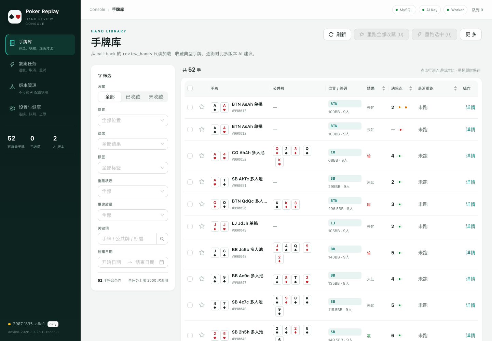
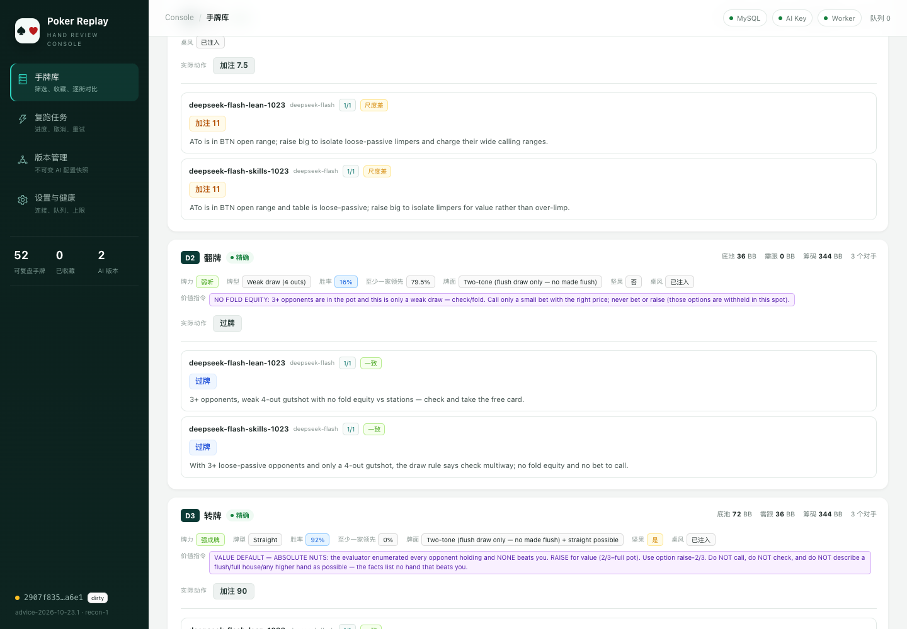
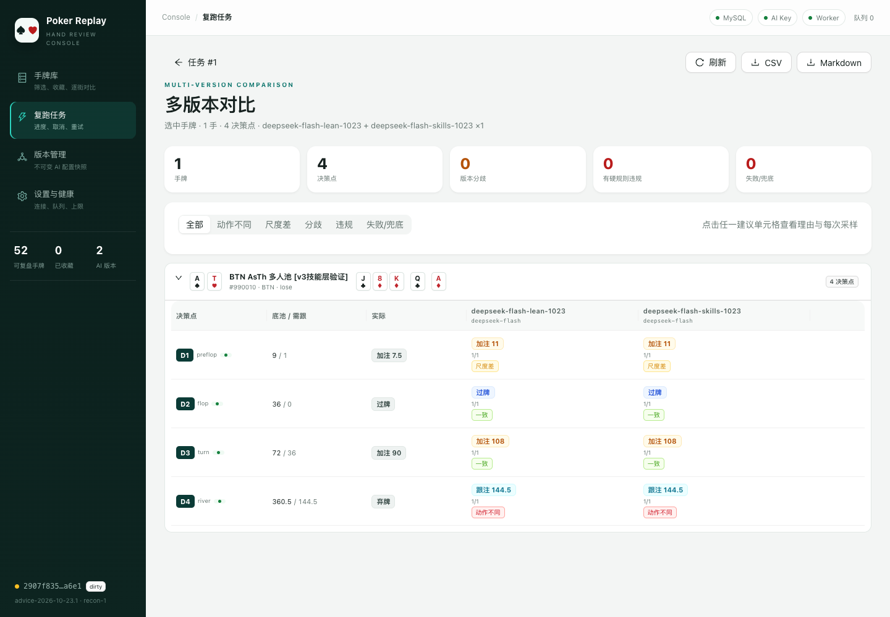
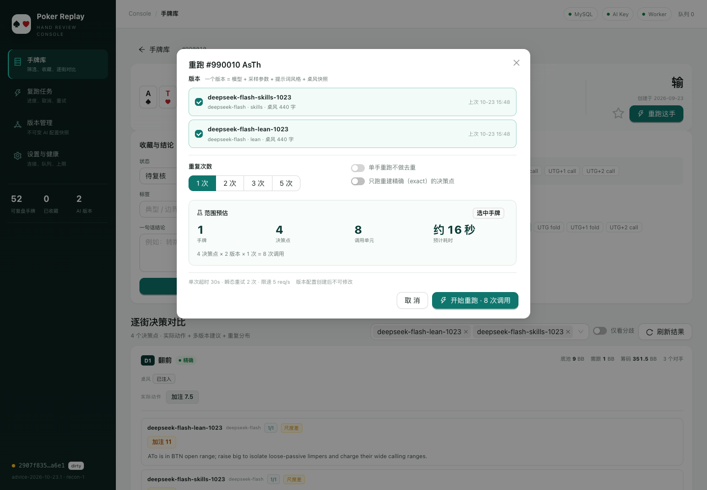

# 手牌复跑控制台（Replay Console）

把「选牌 → 重跑 → 逐街对比多版本 AI → 收藏典型手牌 → 一键全部重跑」做成一个可追溯、可取消、可复现的内部 Web 控制台。

这是按 [`docs/复跑控制台-设计文档.md`](../docs/复跑控制台-设计文档.md) 落地的**独立项目**：

- 后端：FastAPI + PyMySQL，默认 `127.0.0.1:8010`，不加载 OCR 模型；
- 前端：React 18 + Vite + Ant Design 5 + TanStack Query，构建后由 FastAPI 托管；
- 数据库：复用 call-back 的 MySQL 实例；`review_hands` **只读**，新增 `replay_*` 表；
- 重跑引擎：复用父项目 `poker_ocr.advice` 的 `build_situation()` / `advise()`，决策点重建逻辑在本项目的 `replay/decisions.py`；
- 不修改 `call-back` / `call-front` / `api.py` 的任何行为。

> 设计文档的状态是「设计草案 v0.1，本阶段不改代码」；本仓库是在其评审后按 M0–M4 实现的可运行版本。

## 界面预览

| 手牌库 | 逐街多版本决策 |
| --- | --- |
|  |  |

| 多版本对比 | 重跑弹窗 |
| --- | --- |
|  |  |

---

## 1. 已实现功能

| 设计目标 | 实现 |
| --- | --- |
| G1 一个入口看全部可重跑手牌 | 手牌库：底牌/公共牌/位置/筹码/结果/决策点数/最近重跑；筛选、分页、排序、URL 可分享 |
| G2 任意一手牌逐街看多版本建议 | 手牌详情：行动街时间线、D1/D2 锚点、每决策点实际动作 + N 个版本的 option/amount/reason/重复分布 |
| G3 收藏典型手牌并一键全部重跑 | 星标收藏、标签、结论、状态；收藏夹一键重跑；选中多手/当前筛选批量重跑 |
| G4 结果永久可追溯 | 每条结果关联版本快照（模型、采样参数、prompt style、advice_version、桌风 sha、engine commit）与任务快照 |
| G5 重跑不污染生产 | 代码中没有任何 `review_hands` 写入；收藏/标签/结论只写 `replay_marks` |
| G6 失败可恢复 | DB 队列 + 唯一键断点；取消、失败重试、服务重启后 `running` 任务标记失败且已落库结果保留 |

另外实现的功能：

- **重建质量分级**：`exact` / `approx` / `invalid`，页面徽标 + 原因；
- **手牌导入**：手牌库支持导入两种来源——**复盘手牌**（`review_hands` 导出的 JSON/JSONL）和**实时日志手牌记录**（`hands.json` 或 `live.states.jsonl`）；自动识别、预览计数、按内容幂等去重；
- **删除手牌**：列表行内、勾选批量、详情页均可删除；导入手牌软删除（重新导入可恢复），`review_hands` 手牌仅在控制台隐藏，不修改生产业务表；
- **去重**：按手牌内容指纹识别；批量任务默认跳过重复，保留较新的一手；
- **成本与时间预估**：调用单元、预计耗时、超过单任务上限需显式确认；
- **逐 unit 进度**：`done_units / total_units`、分版本完成/失败/兜底/p50；
- **导出**：CSV / Markdown（Markdown 可直接贴进 `docs/复跑-*.md`）；
- **健康检查与设置页**：DB、`review_hands` 可读、AI Key、worker、队列、schema、代码版本；
- **提示词 golden test**：提示词漂移但未 bump `ADVICE_VERSION` 时测试失败。

### 里程碑对照

| 阶段 | 状态 | 说明 |
| --- | --- | --- |
| M0 决策点库 / 迁移 / 列表 API | ✅ | `replay/decisions.py`、`replay/migrations/001_init.sql`、`GET /api/hands` |
| M1 手牌库 / 收藏标签 / 行动街 | ✅ | `/hands`、`/hands/:id` |
| M2 版本管理 / 单手重跑 / 决策卡对比 | ✅ | `/versions`、版本导入/克隆/归档、重跑弹窗、逐街对比 |
| M3 批量任务 / 进度 / 取消 / 重试 / 预估 | ✅ | `/jobs`、任务详情、worker、`POST /api/runs` |
| M4 对比筛选 / 导出 / 质量徽标 / 恢复 | ✅ | 对比视图、CSV/Markdown、保留策略、重启恢复 |
| M5 live log / 线上建议基线 / 多用户 | 🟡 部分 | 已支持导入 live log / `hands.json` 作为第二手牌源；线上建议基线、多用户鉴权未做 |

---

## 2. 快速开始

### 2.1 依赖

父项目已经提供 Python 3.12 + FastAPI + poker_ocr 依赖。控制台额外需要 PyMySQL：

```bash
cd ..                       # poker-ocr 仓库根
uv pip install --python .venv/bin/python -r replay-console/requirements.txt
```

（没有 `uv` 时用 `.venv/bin/python -m pip install ...`；如果 `.venv` 没有 pip，按父项目现有方式安装。）

前端：

```bash
cd replay-console/replay_web
pnpm install
pnpm build                  # 生成 dist/，由 FastAPI 同源托管
```

> `pnpm-workspace.yaml` 已允许 esbuild 的安装脚本，并关闭了 pnpm 的交互式
> `confirmModulesPurge`；如果使用更老的 pnpm 仍提示 `NO_TTY`，在命令前加 `CI=true`。

### 2.2 配置

```bash
cd replay-console
cp .env.example .env
```

最少需要：

- MySQL：默认自动从 `poker-ocr/.env`、`../call-back/.env` 补齐 `DB_*`；也可以在本项目 `.env` 显式覆盖。
- AI Key：在 `poker-ocr/.env` 配置 `AI_SERVER_API_KEY` / `AI_SERVER_BASE_URL` / `AI_SERVER_MODEL`。
- `REPLAY_HAND_USER_ID=0`：读全部 `review_hands`；大于 0 时只读该用户。

启动：

```bash
# 开发
../.venv/bin/python -m uvicorn replay_api:app --host 127.0.0.1 --port 8010 --reload

# 或
./start.sh
```

打开 <http://127.0.0.1:8010>。

首次启动会自动迁移 `replay_*` 表（`REPLAY_AUTO_MIGRATE=1`）。因为目标 MySQL 新建连接握手要 6–8 秒，启动时会并发预热 3–4 条连接；之后查询都在几十毫秒级。

### 2.3 前端开发态

```bash
cd replay-console/replay_web
pnpm dev
# http://127.0.0.1:5173，/api 代理到 :8010
```

生产/本机使用：`pnpm build` 后刷新 <http://127.0.0.1:8010> 即可，不需要单独起前端服务。

---

## 3. 目录结构

```text
replay-console/
├── replay_api.py              # uvicorn / python replay_api.py 入口
├── start.sh
├── requirements.txt
├── .env.example
├── replay/
│   ├── config.py              # 分层 .env、运行配置、git 版本
│   ├── db.py                  # PyMySQL 连接池 + 迁移
│   ├── decisions.py           # review_hands → 决策点 / 指纹 / 质量 / 快照序列化
│   ├── importer.py            # 复盘 / 实时日志手牌 → 统一内部行
│   ├── versioning.py          # 版本不可变配置哈希 / advice_version / 桌风
│   ├── engine.py              # 规则审计、动作分类、模型调用重试、重复分布聚合
│   ├── repository.py          # review_hands 只读 + 导入手牌 + replay_* 读写
│   ├── service.py             # 手牌库/导入/详情/版本/任务/对比/导出/健康
│   ├── runner.py              # DB 队列 worker + 线程池 + 断点恢复
│   ├── worker.py              # 可选独立 worker 进程
│   ├── api.py                 # FastAPI 路由 + SPA 托管
│   ├── schemas.py             # 请求体
│   └── migrations/001_init.sql, 002_imported_hands.sql, 003_hand_deletions.sql
├── replay_web/                # React + Vite + AntD
└── tests/                     # 决策点 / 引擎 / 版本 / API / 提示词 golden
```

数据表：`replay_versions`、`replay_jobs`、`replay_job_hands`、`replay_decisions`、`replay_results`、`replay_marks`、`replay_imported_hands`、`replay_import_batches`、`replay_hand_deletions`、`replay_schema_migrations`。全部是逻辑外键，不修改 `review_hands`。

---

## 4. 关键口径

### 4.1 一个 AI 版本

```text
模型 + 接口地址 + 采样参数 + 提示词风格 + advice_version
+ reconstruct_version + 桌风快照
```

- 版本创建后配置字段**不可修改**，只能改名称/备注/归档；改配置要克隆。
- `config_hash` 不含 `engine_commit`（仅追溯），但包含 `advice_version`、`reconstruct_version`、桌风 sha。
- 版本只有在 `advice_version` / `reconstruct_version` 与当前代码一致、且 Key 环境变量存在时才能创建任务；旧版本只用于看历史结果。
- 桌风在创建版本时冻结；worker 不再读 `.table_dy`。

### 4.2 决策点身份与手牌指纹

- 身份：`(hand_id, hand_fingerprint, reconstruct_version, street, seq)`。
- 指纹只包含会影响建议的字段（底牌/公共牌/位置/筹码/盲注/对手/行动线），改标题、输赢金额、复盘结论**不会**让已有结果失效。
- 同一街 hero 可能行动两次，`seq` 是整手牌内的序号，不是街序号。

### 4.3 重建质量

- `exact`：首街是 `preflop` 且行动线完整（下注/加注金额齐全、没有旧聚合 actor），底池可以从盲注 + 行动精确重建；或每街都有 `potStartBb`。
- `approx`：手牌从翻后开始且缺翻前/起始底池；对手位置/筹码缺失；旧数据 `actor=villain/other`；下注金额缺失；中间某街缺 hero 动作但后面 hero 还有决策。
- `invalid`：`bb<=0`、底牌不是 2 张、行动线为空、没有 hero 决策点。

批量任务可以只跑 `exact` 决策点（弹窗里的「只跑重建精确」）。

### 4.4 执行

- DB 队列 + 单 worker + `REPLAY_WORKERS` 个 unit 线程；默认一次只跑一个任务。
- 每个 unit 的结果先落 `replay_results`，唯一键 `(job_id, decision_id, version_id, repeat_index)` 是天然断点。
- 单次超时 30s；超时/429/5xx/连接错误退避重试 2 次；400、鉴权失败、返回非法选项不重试。
- `advise()` 的 `source=fallback` 会落库并标记「兜底」，但**不**计入模型一致率分母；未捕获异常记 `source=error`，计入 `failed_units`。
- 取消是协作式的；服务重启时 `running` 任务标记失败，已落库结果保留，可点「重试失败/未完成」。

---

## 5. API 速查

| 方法 | 路径 | 说明 |
| --- | --- | --- |
| GET | `/api/meta` | 手牌数、收藏数、版本数、默认版本/重复、健康摘要 |
| GET | `/api/health` | DB、review_hands、AI Key、worker、队列、schema |
| GET | `/api/hands` | 筛选/分页/排序（`favorite`, `source`, `position`, `result`, `tag`, `hasRun`, `quality`, `keyword`, `dateFrom`, `dateTo`, `page`, `pageSize`） |
| POST | `/api/hands/import` | 导入复盘/实时手牌；先 `dryRun=true` 预览，再落库 |
| GET | `/api/imports` | 最近导入批次（来源、计数、状态、错误） |
| GET | `/api/hands/{id}` | 详情 + 行动街 + 决策点元数据 |
| GET | `/api/hands/{id}/comparison` | `versionIds=1,2&jobId=...` 多版本对比 |
| PATCH | `/api/hands/{id}/mark` | 收藏/标签/状态/结论 |
| DELETE | `/api/hands/{id}` | 删除单只手牌（导入手牌软删除；review_hands 仅隐藏） |
| POST | `/api/hands/delete` | 批量删除，body `{"handIds":[1,2]}`，最多 1000 手 |
| GET | `/api/versions` | 版本列表（`includeArchived=1`） |
| POST | `/api/versions` | 新建 |
| POST | `/api/versions/import-env` | 从当前 `.env` + `.table_dy` 导入 |
| POST | `/api/versions/{id}/clone` | 克隆 |
| PATCH | `/api/versions/{id}` | 改名/备注/归档 |
| POST | `/api/runs/preview` | 范围解析与调用/耗时预估 |
| POST | `/api/runs` | 创建任务；超过上限需 `confirmLarge=true` |
| GET | `/api/runs` | 任务列表 |
| GET | `/api/runs/{id}` | 进度、逐手、失败、分版本统计 |
| GET | `/api/runs/{id}/results` | 按手牌分组的对比结果（`only=diff/size/diverged/violation/error`） |
| POST | `/api/runs/{id}/cancel` | 取消 |
| POST | `/api/runs/{id}/retry-failed` | 只重跑失败/未完成手牌 |
| GET | `/api/export?jobId=...&format=csv|markdown` | 导出 |

错误统一为：

```json
{"error": {"code": "VERSION_STALE", "message": "…", "detail": {}}}
```

常见错误码：`HAND_NOT_FOUND`、`VERSION_NOT_FOUND`、`VERSION_ARCHIVED`、`VERSION_STALE`、`INVALID_VERSION_CONFIG`、`AI_KEY_MISSING`、`TOO_MANY_CALLS`、`JOB_QUEUE_FULL`、`JOB_NOT_CANCELABLE`、`DB_UNAVAILABLE`、`EXPORT_EMPTY`。

### 5.1 导入手牌

页面入口：手牌库右上角 **导入手牌**。支持拖入文件或直接粘贴，先「解析预览」再「确认导入」。

请求示例：

```bash
curl -s http://127.0.0.1:8010/api/hands/import \
  -H 'Content-Type: application/json' \
  -d '{"format":"auto","dryRun":true,"dedupe":true,"content":"<文件原文>"}'
```

两种输入：

| 格式 | 典型文件 | 识别依据 | 说明 |
| --- | --- | --- | --- |
| 复盘手牌 | `review_hands` 导出的 JSON / JSONL | `heroCards` / `hero_cards` + `streets[].actions[].actor` | 兼容 camelCase 与 snake_case；`streets` 可以是 JSON 字符串 |
| 实时日志 | `hands.json`、`live.states.jsonl` | `type=hand`、`hero_cards` 数组、`blinds`、`streets[].actions[].seat_id` | JSONL 会自动跳过 `state`/`session_start`；默认跳过 `partial` 和翻后接管手牌。新版记录还带 `hero_stack_bb` / `start_stacks`，直接用于重建筹码约束 |

导入选项：

- `dryRun=true`：只解析、分析、去重计数，不写库；
- `dedupe=true`（默认）：同一来源 + 相同内容更新原记录；库中已有相同内容（包括 `review_hands`）时跳过；
- `allowInvalid=false`（默认）：跳过缺底牌/行动线/bb 的不可重跑手牌；
- `includePartial` / `includeMidHand`：仅实时日志，保留截断手牌/翻后接管手牌。

落库后，导入手牌使用 `1e12` 起的独立 id 段，和 `review_hands` 一起出现在手牌库；来源筛选区分 **复盘库 / 导入·复盘 / 导入·实时**。收藏、决策点、重跑结果与原生手牌共用同一套 `replay_*` 表。

详细字段映射与样例见 [`docs/导入手牌-格式说明.md`](docs/导入手牌-格式说明.md)。

### 5.2 删除手牌

入口：列表行内「删除」、勾选底部「删除选中」、详情页「删除这手」。

删除语义刻意分成两种，避免控制台写生产业务表：

| 手牌来源 | 删除行为 | 能否恢复 |
| --- | --- | --- |
| 导入手牌（复盘/实时） | `replay_imported_hands.deleted_at` 软删除；收藏、决策点、历史结果保留 | 重新导入同一份内容会更新并恢复该记录 |
| `review_hands` 手牌 | 写 `replay_hand_deletions`，列表/详情过滤；**不修改** `review_hands` | 删除对应隐藏记录即可（需手工 SQL） |

批量删除接口：

```bash
curl -s http://127.0.0.1:8010/api/hands/delete \
  -H 'Content-Type: application/json' \
  -d '{"handIds":[1000000000002, 990052]}'
```

返回 `{requested, deleted, imported, reviewHidden, missing}`。已删除手牌不会出现在手牌库、收藏、筛选和重跑范围中；历史任务的结果行仍保留用于追溯。

---

## 6. 测试

```bash
cd replay-console
CI=true ../.venv/bin/python -m pytest tests -q
```

覆盖：

- 决策点重建：preflop 起始 exact、bb=0 invalid、翻后起始 approx、旧 actor approx、缺 hero 动作 approx、指纹排除标题/输赢、快照 JSON roundtrip；
- 引擎：preflop 尺度容差、`open-4` 这类 option id 的 kind 映射、重复分布、fallback 不计入一致率、对比数据结构；
- 版本：配置哈希稳定性/敏感性、Key 缺失/归档/旧语义 blocker、public view 不泄露 Key；
- 导入：复盘 JSON/JSONL、实时 `hands.json`/原始日志、自动识别、partial/中途接管过滤、去重/更新/不可重跑、预览不写库；
- 删除：单删/批量删除、导入手牌软删除、review_hands 仅隐藏、missing 返回、参数校验；
- API：meta、校验错误、收藏、创建任务、错误 envelope、导出头、导入与删除路由；
- 提示词 golden：改动提示词但未 bump `ADVICE_VERSION` 时失败。

前端类型检查与构建：

```bash
cd replay_web
CI=true pnpm typecheck
CI=true pnpm build
```

---

## 7. 运维

- 日志：`replay-console/logs/replay-console.log`（10MB 轮转 3 份）；结构化字段由 logger 输出，不打印 Key/完整 prompt。
- 独立 worker（可选）：

  ```bash
  # API 进程
  REPLAY_WORKER_ENABLED=0 ../.venv/bin/python -m uvicorn replay_api:app --host 127.0.0.1 --port 8010
  # worker 进程
  ../.venv/bin/python -m replay.worker
  ```

- 默认只绑 `127.0.0.1`。对局域网开放时设置 `REPLAY_TOKEN`；非本机请求必须带 `Authorization: Bearer <token>`。
  前端会从浏览器 `localStorage.replay_token` 读取并附加这个头；内部局域网使用时先执行
  `localStorage.setItem('replay_token','...')`，或在前置代理里统一注入。
- 保留策略：`REPLAY_STORE_PROMPTS=0` 不存 prompt/raw；`REPLAY_RETENTION_DAYS` > 0 时启动会清理超期结果的 prompt/raw（不删结果行）。
- 备份：`replay_*` 与业务库同实例，跟随现有备份策略。

---

## 8. 与设计文档的差异 / 边界

1. **项目位置**：设计文档写的是在 poker-ocr 根下加 `replay_api.py` / `replay/` / `replay_web/`；这里做成独立 `replay-console/` 子项目，通过父路径复用 `poker_ocr`。原因：新项目边界更干净，不污染根目录；启动命令和端口保持一致。
2. **一次只跑一个任务**：设计里的 `REPLAY_MAX_CONCURRENT_JOBS` 默认 1；当前实现是单 worker 循环，先不做多任务并发。`REPLAY_WORKERS` 控制单个任务内的 unit 并发（默认 2）。
3. **M5 部分完成**：已支持导入 live log / `hands.json` 作为第二手牌源（复盘手牌也支持导入），但**不导入线上当时的 AI 建议**作为对比基线，也不做多用户鉴权。
4. **设置页只读**：改上限/保留策略仍通过环境变量；页面只展示与健康检查。
5. **版本「测试连接」**：设计里标可选的按钮未实现，避免误点消耗额度。
6. **跳过的重复/不可重跑手牌**：只记在任务 `config_snapshot.skipped` 与响应里，不写 `replay_job_hands`；`replay_job_hands` 只包含真正进入任务范围的手牌。
7. **`exact` 的口径**：按设计「首街 preflop 且行动线完整」允许没有 `potStartBb`，因为底池可由盲注 + 行动精确重建；这是为了避免把库里绝大多数手牌都误标成 approx。
8. **收藏夹分组**：按设计默认做单层标签，不做分组。

---

## 9. 与现有 CLI 的关系

| CLI | 控制台 |
| --- | --- |
| `tools/replay_hand_repeat.py --hand ...` | 手牌详情 → 重跑这手 |
| `tools/compare_review_hands.py /tmp/review30.jsonl --model` | 手牌库筛选 → 批量重跑 → 对比视图 |
| `tools/compare_advice_styles.py` | 两个版本（lean / skills）跑同一批手牌 |
| `tools/export_hands.sql` | 不再需要手写；控制台直接读 `review_hands` |

CLI 仍是可用的；控制台不改变它们的输入/输出格式。
