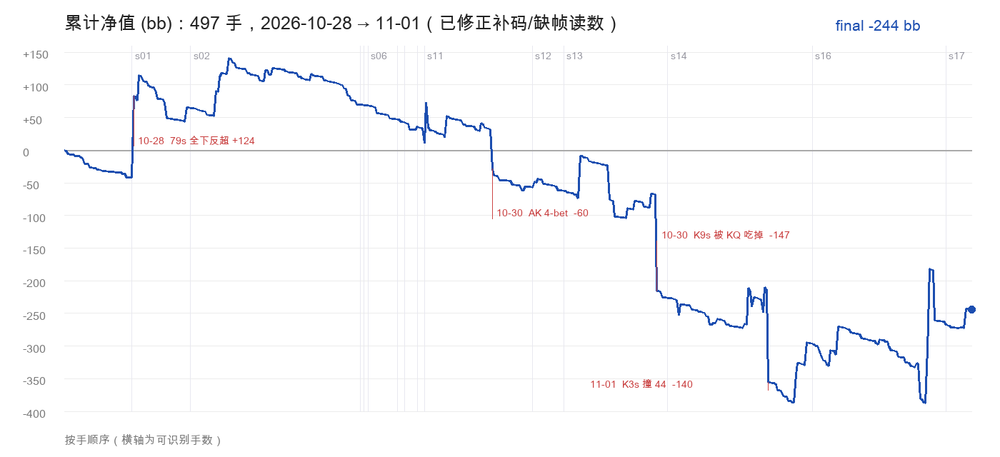

# 全量手牌复盘：497 手、5 天、-244bb

> 数据：`logs/live.states.jsonl`（2026-10-28 19:48 → 11-01 21:42）
> 口径：9-max，盲注 0.5/1（APP 显示 1/2），前注 0.5/人，买入 100 → 10-30 起 200
> 工具：`tools/hand_leak_report.py`（本报告的所有数字都能复跑）
> 提示词：`lean-zh-2026-11-01.4`（第四章的规则已写进 system + 事实块）



---

## 一、先说结论

1. **真实净输约 -244bb（≈ -0.51bb/手），不是 `hand_group_stats.py` 报的 -530bb。** 老脚本的净值 guard 把「赢的比自带筹码还多」的合法大胜丢了 6 手（+339.5bb），又漏掉一笔缺帧的 -53；一减一加，总账差了一倍多。
2. **输的钱几乎全部来自 3 手牌**：K3s 撞 44（-140.5）、AK 4-bet 打光（-60.5）、54o 在 6-2-7 面全下（-53）。这 3 手合计 **-254bb**，其余的牌（含所有赢的 +157）基本抵平。
   K9s 那手 -147 **是冤家牌**（KKK55 撞 KKKQQ），不算漏 —— 同一条街上两边都成葫芦，换个打法也躲不掉。
3. **不是「每手都打错」**：VPIP 20.9%、UTG 只有 8% 入池、输钱之后入池率反而只从 20.9% 涨到 22.4%（没有明显 tilt）。翻前框架是合格的。
4. **问题在「大池里用非坚果打光」**：单笔亏 ≥20bb 的 12 手（含缺帧那手）合计 ≈ **-685bb**，超过整段亏损；而 ≥150bb 的底池 89 手里你只赢了 **2** 手。你在这张桌子上是「用中等强牌去撞别人的坚果」。
5. **你几乎在严格执行 AI 建议**：建议的下注尺寸和你的实际下注，85 次里 73 次完全一致（86%）。所以这不是「没听话」的问题，是**这套线本身的权益/弃牌率假设在这张桌子不成立**。

---

## 二、总账（先把钱算对）

### 2.1 净值口径

用相邻两手的起始筹码相减，只在同一个 session 内相邻才有效（跨 session 是重买/换桌）。
三类读数特殊处理（`tools/hand_leak_report.py` 已经内置）：

| 情况 | 判定 | 本次 |
|---|---|---|
| 赢的钱超过底池字段 | 多半是 `pot` 串到了下一手；只要没超过 2 倍底池就**照赢算**并标 `win_pot_undercounted` | 1 手（+21.5） |
| 正跳变太大、且这手没有任何行动 | **补码**，不计入净值 | 1 手（+99.5，10-30 22:13） |
| 中间一手缺筹码读数 | 把跨过缺口的差记在缺口前一手（`gap`），否则整笔钱会被漏掉 | 1 手（-53） |

**老脚本 `hand_group_stats.py` 的两个 bug**：

1. `abs(delta) > start` 会把「赢的比自带筹码多」的合法大胜丢掉 —— 一手里赢到的钱本来就可以
   超过自带筹码（对手的钱也在池里）。这份日志里它丢掉了 **6 手真实大胜**（+124.5 / +42.5 /
   +35.5 / +33.5 / +21.5 / +82，合计 +339.5bb）；
2. 缺筹码读数那一手跨过的 **-53bb** 完全没算进去。

一减一加，报表上的 **-530.5** 才是真实的 **-244**。

### 2.2 修正后的账

| 项 | 值 |
|---|---|
| 可读手数 | 479 / 497 |
| **净值** | **-244.0bb** |
| 均值 / 标准差 | -0.51bb/手；单手 σ=16.4 |
| 标准误 | ±0.75bb/手 → -0.51 在 **0.7σ** 以内 |
| 期间最低点 | -387bb（11-01 21:26，就在 K4s +123.5 那手之前），最后打回 +143 |

> **方差的诚实结论**：500 手、5 小时，这个样本量证明不了「你是不是输家」。标准差 16.4bb/手，497 手的随机波动就有 ±365bb。所以下面不靠「输了多少」下结论，只看**输在哪、怎么输的** —— 那部分是可复现的。

### 2.3 按天

| 日期 | 手数 | 净值 | 备注 |
|---|---|---|---|
| 10-28 | 66 | **+65.0** | 79s 全下反超 +124.5 |
| 10-29 | 118 | -34.0 | 平稳磨损 |
| 10-30 | 131 | **-257.0** | AK 4-bet、54o 全下、K9s 撞 KQ；中途补码 +100 |
| 11-01 | 164 | -18.0 | K3s 撞 44（-140.5）被后两场赢回来 |

**「持续输」的真相是「一晚输掉全部」**：10-30 一个晚上 -257，其余三天合计 +13。这一晚恰好有一次 **+99.5 的补码**（22:13），补完 55 分钟后又输掉一手 147。

### 2.4 单手盈亏分布（479 手）

| 区间 | 手数 | 合计 | 均值 |
|---|---|---|---|
| ≤ -80 | 2 | **-287.5** | -143.8 |
| -80 ~ -40 | 4 | -244.0 | -61.0 |
| -40 ~ -20 | 6 | -154.0 | -25.7 |
| -20 ~ -10 | 4 | -51.5 | -12.9 |
| -10 ~ -2 | 63 | -376.0 | -6.0 |
| -2 ~ 0 | 361 | -243.0 | -0.7（前注 + 弃牌成本） |
| > 0 | 39 | **+1112.0** | +28.5 |

- **12 手 ≤ -20 合计 -685.5bb**，约占全部毛亏损的一半（其中 K9s -147 是冤家牌，可改的是剩下 11 手的 -538.5）。
- 赢的 39 手平均 +28.5，输的 416 手平均 -3.3（中位数 -0.5）。**赢的时候赢得不小，输的时候输得太集中** —— 这是「大池打光」型输家的典型形状。
- 361 手 -0.7 的小额磨损是前注成本，不是漏。

---

## 三、逐手复盘：钱是怎么没的

### ① 10-30 23:08　K9s（SB）　-147bb　**最大单笔**

```
翻前  SB 跟 4（4 人池，底池 20）
翻牌  Ks Kc Qs    你下注 10（½池），两家跟
转牌  5s          你下注 25（½池），一家跟
河牌  5h          你下注 50，UTG+1 加到 107.5，你跟 57.5
你的牌 K K K 5 5（葫芦，K 带 5）　对手亮 Kh Qc = K K K Q Q
```

- **这是冤家牌，不算漏**：翻牌两人都中三条/两对，转河各成葫芦，KKK55 撞 KKKQQ —— 对手拿着 KQ 本来就要打光，
  你拿着葫芦也弃不掉。这类手（-147）不计入「可改的亏损」。
- 唯一可讨论的是尺寸：½池 × 3 条街让 KQ、55 跟得很舒服。但就算打满池，这条线大概率还是打光，**不构成必修项**。
- 顺带说明：AI 当时写「权益 91%」是「对跟注范围」算的，不是错 —— 只是对手河牌加注后范围已经收窄到 KQ/55，
  权益不该再按 91% 理解。**这条我们按你的判断不修**（见第六章 D）。

### ② 11-01 14:56　K3s（LJ）　-140.5bb　**炸弹池**

```
翻前  炸弹池，8 人各交 5bb，底池 45
翻牌  6h Kd 9d    全员过牌
转牌  4h          你下注 30（⅔池），UTG+1、HJ 跟
河牌  Kh          UTG+1 下 63，你跟；HJ 加注到 110，你再跟 47
你的牌 K K K 9 6（明三条，踢脚 3）　HJ 亮 4d 4s = 4 4 4 K K（葫芦）
```

- 明三条、踢脚 3、8 人池、成花成对的面 —— 这是**最不该建池的牌型**，你却在转牌主动下注 30（**偏离了建议的「过牌控池」**）。
- 河牌面对「下注 + 加注」还用三条跟 47bb：对手范围里 K6/K9/K4、44、99、66、QJhh 全在，你只赢纯诈唬。
- 一手牌就吃掉了整段亏损的 58%。

### ③ 10-30 22:08　AK（UTG）　-60.5bb　**执行偏差**

```
翻前  你开 5 → LJ 3-bet 20 → 你 4-bet 60 → 你再加到 100（≈全下）
翻牌  2c 4d 4c    你过牌，LJ 全下 186，你弃
```

- 建议写的是「4-bet 到 60bb」，你加到了 100。**多出的 40bb 是纯亏**：这个 3-bet 范围是 QQ+/AK，AK 打光只有 40%。
- 4-bet 到 100 之后你已经没有退路：翻牌只有 A 高 + 卡顺，面对全下只能弃，100bb 里贡献给底池的部分全部沉没。

### ④ 10-30 22:49　54o（BB）　-53bb　**按建议推的，但这是最不该推的牌型**

```
翻前  溜入池，BB 过牌
翻牌  6s 2c 7h    你下/跟 5，CO 加到 27.5，你全下 29BB（有效筹码 24BB，SPR 0.5）
转牌  7d          对手亮 7s 4s（转牌成葫芦），你的两头顺只剩 8%
```

- 建议原文：「有效筹码仅 24BB，SPR0.5，全下 29BB」。工具**算对了有效筹码**（对手后手只有 24BB），
  但把「8 张补牌两条街 ≈31%」当成了足够 —— **这张桌子对手两对/三条都会跟**，你的 31% 只有在
  「对手会弃牌」时才成立。
- 5 高、两头顺、无摊牌价值，在 45 的池里推 24BB：赔率上勉强，**期望上却是拿 24bb 去赌一个不存在
  的弃牌率**。这手和 ① 是同一个病：在「没有弃牌率」的桌子上用听牌/中等牌买赔率。
- 注：这手的记录本身是破的（两条重复记录、两手的底池对不上、栈一度读到 0），净额 -53 是从
  跨过缺口的两端筹码算出来的。这类破损记录是「必须先修日志再谈复盘」的直接证据。

### ⑤ 11-01 21:30　KK（HJ）　-77.5bb　**打得没大错，但可以更省**

```
你开 7，两家跟；翻牌 7h 9c 6s 你下 17.5（⅔），两家跟；
转牌 4c 你下 52.5，SB 加到 170.5，你弃。
```

- 超对在「7-9-6 两花」这种湿面，转牌 2/3 池是**把一个只能赢更差超对的牌打成大池**。
- 打两条街后弃牌本身对（-77.5 是「学费」），但转牌过牌控池能把这手从 -77.5 压到 -25 左右。

### ⑥ 11-01 21:24　KQ（HJ）　-53bb　**这手不算漏**

翻牌顶对 + 两头顺，½池 + ½池 + 过牌，输给 QT 两对。这是正常的 cooler，不用改。

### ⑦ 11-01 21:28　K4s（SB）　**+123.5bb**　**同一种动作，另一种结果**

```
翻前 SB 补 1；翻牌 10c Kc 6s 全员过；
转牌 BB 加注 30，你跟；河牌 BB 下 79，你跟 79 赢。
```

- 你用**第二对、踢脚 4** 跟了河牌 79（≈2/3 池）。这手赢了，但和 ① 的河牌跟注是**同一类决策**：拿中等强度去抓对手的价值线。
- 这类跟注在日志里有赢有输，长期看是负期望 —— **别用结果给动作打分**。

---

## 四、可量化的画像

### 4.1 位置（净值只作参考，样本太小）

| 位置 | 手数 | 主动入池 | 加注 | 净值 | 每手 |
|---|---|---|---|---|---|
| UTG | 61 | **8%** | 7% | -89.5 | -1.54 |
| UTG+1 | 49 | 14% | 10% | +118.0 | +2.57 |
| UTG+2 | 37 | 14% | 8% | -22.0 | -0.59 |
| LJ | 56 | 18% | 11% | -147.5 | -2.68 |
| HJ | 62 | 24% | 14% | -186.0 | -3.15 |
| CO | 61 | 26% | 7% | +164.0 | +2.78 |
| BTN | 61 | **41%** | 20% | -77.0 | -1.33 |
| SB | 53 | 34% | 4% | +5.0 | +0.10 |
| BB | 57 | 5%\* | 2% | -9.0 | -0.16 |

\* BB 的入池率被「过牌」吃掉了，日志抓不到 BB 跟注，别当真。

**可以信的只有入池结构**：UTG 8% 很自律，BTN 41% 偏松但不离谱，**SB 34% 明显过松**（0.5 前注下 SB 应该更紧，因为你要在翻后无位置打）。

### 4.2 起手牌型

| 牌型 | 手数 | 入池 | 净值 |
|---|---|---|---|
| 口袋对 | 31 | 61% | +81.5 |
| A同花 | 14 | 79% | +2.0 |
| 同花大牌 | 7 | 71% | -44.0 |
| 同花连张 | 22 | 41% | +85.5 |
| 弱同花 | 57 | 10% | **-125.5** |
| A杂色 | 57 | 35% | -46.0 |
| 杂色大牌 | 15 | 27% | +75.0 |
| 杂牌 | 292 | 10% | -271.5 |

- 口袋对 +81.5、同花连张 +85.5：**这两类是正贡献**，说明翻前框架没大问题。
- 弱同花 -125.5：Q7s / K6s / K3s 这种「看着能玩」的牌是主要漏水 —— 其中 K3s 一手 -140.5 就超了。
- 杂牌 -271.5 里有约 -146 是前注成本（292 手 × 0.5），剩下的是翻前后的小额跟注。

### 4.3 尺寸

| | 你的中位数 | 桌子中位数 |
|---|---|---|
| 翻前开池 | **7bb** | 8.5bb |

- 全桌开池 8.5bb，你开 7bb。**你每次都在给别人好的跟注价格**，同时把自己搞成 3-4 人池、无位置。
- 翻后下注集中在 ½ 池：47 次下注里绝大多数是 ½~⅔。**½ 池在多人池既不保护也不弃牌**，只是把底池喂大。

### 4.4 炸弹池（5bb 前注、翻前无行动）

- 41 手（约 8%），合计 **-28bb** —— 从总账看几乎是零和。
- 但拆开看：**K3s 一手 -140.5，其余 40 手合计 +112.5**。也就是说你不是「在炸弹池里慢慢漏水」，
  而是**一手把 40 手的收益全部吐回去**。
- 41 手里真正交过手的只有 8 手，其余都是 -0.5（过牌/弃牌）。交手的 8 手是：
  **-140.5（K3s，三条街）、-23（KK 超对转牌下注、被加注就弃）、-23（47s 翻牌跟一注就停）、
  -2（无动作）、+33.5 / +38.5 / +43 / +64.5（都是「一条街内结束」或摊牌）。**
  也就是说：**一条街的顶对打法本身不亏，唯一的大坑是打了三条街。**
- **回测「顶对以上只打一条街」**：唯一的大坑 K3s 是明三条打满三条街（转牌下注 30 + 河牌跟 63 + 再加注跟 47）。
  如果河牌过牌/弃牌，这手从 **-140.5 变成约 -35**，炸弹池整体从 **-28 变成约 +77**。
- 所以炸弹池的风险不在「顶对能不能打」，而在**「打了一条街之后还继续跟」**：
  低 SPR 的池子，一个判断失误就是 1~1.5 个买入。

### 4.5 成牌与摊牌

| 你的最终成牌 | 手数 | 赢 | 净值 |
|---|---|---|---|
| 同花 | 9 | 2 | +134.0 |
| 一对 | 94 | 8 | +128.0 |
| 高牌 | 33 | 0 | -61.5 |
| 两对 | 33 | 3 | -109.0 |
| 三条 | 9 | 1 | -125.0 |
| 葫芦 | 7 | 2 | -48.0 |
| 顺子 | 11 | 0 | -24.5 |

**关键信号**：你的「一对」是赚钱的（+128），「两对 / 三条 / 葫芦」是亏钱的（合计 -282）。
（注意：葫芦那一档 -48 里有 -147 是 K9s 冤家牌、+63/+38 是赢的，剔除后这一档基本是平的。）

这个结论不是被弃牌稀释出来的，换三种口径都一样：

| 口径 | 一对 | 两对 | 三条 | 葫芦 |
|---|---|---|---|---|
| 所有 5 张公共牌 | +128（94 手） | -109（33） | -125（9） | -48（7） |
| 只用投资 ≥10bb 的 | +196.5（10） | -59.5（6） | -110.5（2） | -45.5（3） |
| 只用对手亮牌的 | +159（69） | -118（28） | -155（8） | -149（4） |

反过来说，你拿到**真正的坚果**（同花 9 手）是 **+134**。

所以问题不是「打大池」，而是**牌力不够却当坚果打**：一对时你知道自己牌不大，会控池（所以赚）；
两对/明三条时你把它当成「大牌」，建池、跟加注、打光 —— 而在这个多人池的桌子，它们大多数时候是第二好牌。

### 4.6 执行度：你基本在照着 AI 的建议打

| 建议类型 | 次数 | 你照做 | 同意率 |
|---|---|---|---|
| 下注/加注 | 85 | 73 次**尺寸完全一致** | 86% |
| 跟注 | 79 | 62 | 78% |
| 过牌 | 122 | 80 | 66% |
| 弃牌 | 379 | 268 次没再投钱 | ~71%\* |

\* 弃牌没法直接验证（日志几乎不记录你的弃牌），这里的 37 次「建议弃牌但你投了钱」里有一部分是街内时序造成的误判；明确的**反向偏离**只有两处：**AK 4-bet 加到 100**（建议 60）和 **K3s 转牌下注 30**（建议过牌）。至于 54o 全下、K9s 河牌跟注，都是照建议打的。

**结论**：你的执行很到位，输的钱主要不是「没听建议」，而是**建议本身在这张桌子上错了**——尤其是河牌「权益 91%」和炸弹池「赔率门槛足够」这两类跟注。

---

## 五、为什么会「持续输」

按影响从大到小：

1. **非坚果强牌在大池里打光。**
   K9s（葫芦）、K3s（明三条）这类牌，在**公对面 / 成花面 / 多人池**里被加注时，你仍然按「我是大牌」继续。这张桌子的对手是松-被动型，**河牌加注几乎全是价值**。这两手 -287.5，超过了整段亏损。

2. **翻前尺寸偏小 → 被迫在多人池里打边缘牌。**
   开 7bb（桌子 8.5bb），每次 3-4 人看翻。多人池里「两对/明三条」的价值暴跌，因为撞更大牌的频率翻倍。你打的是单挑的价值观，进的却是多路池。

3. **炸弹池的风险没有隔离出来。**
   41 手合计 -28、其余 40 手 +112.5，一手 K3s 就 -140.5 —— 炸弹池不是持续漏水，而是
   **一次判断失误吃掉几十手利润**。K3s 的问题不是「顶对/三条能不能打」，是**打了一条街之后还继续跟**
   （转牌下注 + 河牌两次跟注）；SPR≈3 的池子，第二条街开始就该收手。

4. **权益门槛用在「加注范围」上会高估。**
   AI 把「对手的跟注范围」当成「对手的加注范围」：K3 河牌「赔率门槛 24% 足够，跟注」就是这么来的。
   **赔率够 ≠ 该跟** —— 对手在加注时的范围比跟注时窄得多。
   （K9s 那手的 91% 属于冤家牌范畴，不在这条里。）

5. **方差掩盖了结构。**
   500 手的 σ 是 ±350bb，所以你看到的 «持续输» 里，有一部分真的是运气；但「每 80-100 手必有一手 -100 以上的爆仓」不是运气，是同一个动作重复出现。

6. **补码后的行为。**
   10-30 22:13 补 100bb，55 分钟后用 K9s 输 147。补码本身没问题，但**补完继续用同样的线打**，等于把亏损放大一倍。

---

## 六、修正清单（按优先级）

### A. 立刻能改的（这周就能少输 100~200bb/晚）

1. **河牌被加注 = 弃掉所有非坚果。**
   这张桌子的河牌加注 95% 是价值。明三条、非坚果葫芦、两对，面对河牌加注一律弃（除非你有位置且对对手有明确诈唬读数）。
2. **非坚果不建三条街的池。**
   明三条 / 两对 / 超对：最多两条街，第三条街（尤其成花成对面）转成过牌控池。**河牌主动下注只用坚果和纯诈唬**，不要用「中等强牌求薄价值」。
3. **炸弹池：顶对及以上，只打一条街。**
   - **顶对 / 两对 / 明三条**：主动下注只打一条街（翻牌或转牌二选一），下一街过牌；
     被加注就弃 —— 不打第二枪，也不做河牌大额跟注。
   - **低于顶对**（中对、弱对、纯听牌）：默认过牌/弃牌，**不主动下注**。
     只有**同时**满足三条才跟一注：
     ① 有位置；② 对手画像能读出来（疯子 / 高弃牌率）；③ 赔率 ≥ **3:1**
     （落地成下注尺度就是：对手下注 **≤ ½ 池**才够，超过就弃）。
   - 依据见 4.4 的回测：41 手里唯一的大坑就是打了三条街的 K3s。
4. **听牌不做「无弃牌率」的全下。** 这张桌子的跟注站不会弃牌，听牌只按赔率跟注，不要用全下去
   「买弃牌率」；要推就只用坚果听牌 + 有位置 + 对手确实会弃。

### B. 翻前调整

5. **开池尺寸加到 8~10bb**（跟桌子一致），别用 5~7bb 造多人池。宁可少入池，也要有主动权。
6. **对溜入用 3-bet 隔离**（8~10bb + 每个溜入者 +2bb），把多人池打成单挑。
7. **4-bet 只用 KK/AA**。这张桌子的 3-bet 范围是 QQ+/AK，AK 只跟不 4-bet；AQ/AJ 直接弃。
8. **SB 收紧到 25% 以内**，无位置不玩弱同花（Q7s/K6s 这类直接弃）。

### C. 已经落地的（本次代码改动，`lean-zh-2026-11-01.4`）

9. **提示词加了四条硬规则**（`poker_ocr/advice.py`，system 仍是 1898 字符，没超 1900 的预算）：
   - 河牌：「非坚果不打三条街，河牌被加注默认弃」；
   - 炸弹池：「顶对及以上只打一条街——下注一街后过牌收手，**之后被下注/加注即弃**；低于顶对默认
     过牌/弃牌、不主动下注，只有「有位置 + 画像可读（疯子/高弃牌率）+ 赔率 ≥ 3:1」才跟一注」；
   - 翻前：「4-bet 只用 KK/AA，AK 只跟」。
10. **事实块同步**（`render_explosive_zh`）：炸弹池不再写「只用超强范围（含三条）继续、顶对/超对降级」，
    换成上面那条「一条街」规则 —— 否则事实块会压过 system（事实优先级第 2 档高于经验第 5 档）。
11. **4-bet 事实修掉一个反例**（`_facing_raise_zh`）：面对 3-bet 时原来对范围内所有牌都写
    「可以跟注或 4-bet」，AK/QQ 都在内 —— 这正是 10-30 那手 AK 把 100bb 打光的直接诱因。
    现在只有 **AA/KK** 才给「可以 4-bet」，其余写「可以跟注，不 4-bet（4-bet 只用 KK/AA）」。
    回放同一决策点已验证：`AKo … → 可以跟注，不 4-bet（4-bet 只用 KK/AA）`。
12. **测试同步**：`tests/test_advice.py` 改了 5 处断言、新增 `test_explosive_pot_one_street_is_enforced_on_river`
    和 `tests/test_hand_leak_report.py`，全套 37 个套件通过。

#### 6.C.1 全量回放校验（676 个决策点）

用 `tools/replay_live_decisions.py --model` 把日志里**全部 676 个决策点**重跑了一遍：

| 项 | 结果 |
|---|---|
| 决策点 / 错误 | 676 / **0** |
| 建议变化 | 91（13.5%），再问一遍 **85/91 保持新答案**（不是抖动） |
| 目标手的表现 | AK 4-bet → **call**；K3s 河牌两个点 call → **fold**；炸弹池另外 2 处按一条街规则收手 |
| 是否引入回归 | **没有**。把 system 还原成改动前的版本，13 个「开池→平跟」里 12 个仍然是平跟 —— 这批变化早于本次改动 |

但这次回放顺手暴露了一个**独立的、更早的漂移**：现在这套提示词在 13 个「前面有人溜入、我在后位」
的场合选**平跟 1BB**，而当时线上给的是**开池到 3～4 倍（≈7-8BB）**。12/13 在还原 system 后仍然平跟，
说明是提示词版本漂移，不是本次改动。这和你「开池加到 8-10bb」的结论正好相反，值得单独查一次。

### D. 工具还没动的

13. ~~河牌权益门槛按加注范围重算~~ —— **不做**（2026-11-01 决定）：K9s 判为冤家牌，这手不是工具的问题；
    炸弹池那类「明三条跟河牌加注」已经由新规则覆盖，不需要再动权益引擎。
14. **`tools/hand_group_stats.py` 的净值 guard**：`abs(delta) > start` 只对**输**成立；赢的上限是
    `pot + 1`，不是自带筹码。这一条让报表丢掉 6 手真实大胜（+339.5bb），把 -244 报成了 -530。
15. **补码识别**：两手之间「涨得比底池多」的正跳变，要标成补码而不是赢（本次 +99.5）。

### E. 资金/行为

16. **一晚 -100bb 停手**。10-30 那晚 -257，其中 -147 发生在已经 -100 之后。
17. **补码后不下大池**：补码说明你已经在情绪里，接下来 30 分钟只打坚果。

---

## 七、附录

### A. 亏损最大的 15 手（按金额，前 12 手都 ≥ 20bb；★=冤家牌/记录破损，不算漏）

| 时间 | 手牌 | 位置 | 底池 | 净值 | 一句话 |
|---|---|---|---|---|---|
| 10-30 23:08 | K9s | SB | 257.5 | **-147.0** | **冤家牌**（KKK55 撞 KKKQQ），不算漏 |
| 11-01 14:56 | K3s | LJ | 418.0 | **-140.5** | 炸弹池明三条弱踢，跟到河牌加注 |
| 11-01 21:30 | KK | HJ | 354.5 | -77.5 | 湿面超对连打两条街后弃 |
| 10-30 22:08 | AK | UTG | 311.5 | -60.5 | 4-bet 到 100 后被全下，弃 |
| 11-01 21:24 | KQ | HJ | 130.5 | -53.0 | 顶对 + 两头顺，输 QT 两对（cooler） |
| 10-30 22:49 | 54o | BB | 45.0 | -53.0 | 6-2-7 面用 24BB 有效筹码全下（记录破损） |
| 10-30 21:43 | AQ | HJ | — | -38.5 | 顶两对撞 66（记录破损） |
| 10-30 22:52 | 98o | CO | 107.5 | -24.0 | 溜入后跟加注，翻牌跟注 |
| 10-28 20:24 | KK | BB | 185.0 | -23.0 | 炸弹池 KK 转牌下注被加注，弃 |
| 10-30 21:41 | 75o | BTN | 188.5 | -23.0 | 7-4-6 面弱对 + 卡顺，翻牌加注 |
| 11-01 14:48 | 47s | LJ | 90.0 | -23.0 | 炸弹池翻牌跟 22.5 |
| 11-01 14:19 | AKo | BTN | 97.5 | -22.5 | 3-bet 到 22，A 高面弃 |
| 11-01 14:53 | K7s | BTN | 6.0 | -19.5 | 转牌下注被加注 |
| 11-01 14:32 | K9o | SB | 42.5 | -12.0 | 三条街下注，河牌被下注 |
| 10-29 22:30 | AJ | LJ | 30.0 | -10.0 | 加注后被 3-bet，弃 |

### B. 读数据时要小心的坑

- **hero 动作是抽样的**：约 30 秒一帧，漏检多；VPIP/PFR 只能当**下限**看，翻后的「跟注」很多没记录到（全日志只有 21 次翻后跟注被记录）。
- **`street_active` 不可信**：弃牌的 hero 仍会被算进「在局」，别用它算「看翻牌率」。
- **pot 字段偶发串到下一手**（本次 4 处），所以净值要靠筹码序列，不能靠底池反推。
- **`bomb_pot` 标记会串**：结构化判据（翻前无行动 + pot_start 是 5 的整数倍且 ≥25）比标记可靠。

---

*可复跑：`nv tools/hand_leak_report.py`（加 `--json` 出机器可读版，`--top 30` 看更多亏损手）*
